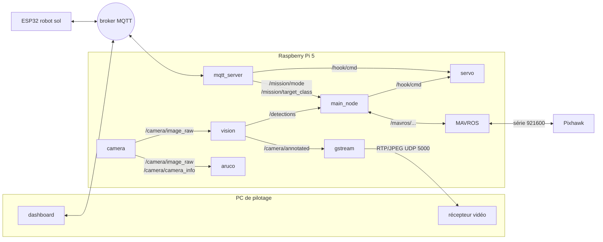

# Architecture ROS 2 du drone

Le code embarqué est découpé en **nœuds ROS 2** (Jazzy) qui échangent des messages sur des topics. Le lien avec la Pixhawk passe par **MAVROS**, et celui avec le PC de pilotage et le robot sol (ESP32) par **MQTT**, qui garde le protocole de 2026. Le même code tourne sur la Pi et dans la simulation : seules les sources de quelques topics changent (voir [simulation.md](simulation.md)).

## Paquets

Tout est dans `drone/`, qui est un workspace colcon avec un paquet par rôle :

```
drone/
├── droneload_bringup/            # lancement et paramètres (sans code)
│   ├── launch/drone.launch.py    # lance tout
│   ├── launch/mavros.launch.py   # MAVROS, seule configuration (drone et simu)
│   └── config/drone.yaml         # paramètres de chaque nœud
├── droneload_vol/
│   └── droneload_vol/
│       ├── main_node.py          # nœud principal : modes, appel des missions
│       ├── mavros.py             # MavrosDrone : commandes et état de l'autopilote, sans bloquer
│       └── missions/             # décollage, atterrissage, épreuve 1, épreuve 2
├── droneload_vision/             # traitement d'image seulement (aucun matériel, testable partout)
│   └── droneload_vision/
│       ├── vision.py             # détection YOLO
│       └── aruco.py              # ArUco : identifiant et pose 3D (calibration de /camera/camera_info)
└── droneload_hardware/           # entrées/sorties du drone : capteurs, actionneurs, liaisons au sol
    └── droneload_hardware/
        ├── camera.py             # caméra Module 3 (Pi seulement)
        ├── servo.py              # servo du crochet (GPIO 13)
        ├── gstream.py            # flux vidéo vers le PC
        └── mqtt_server.py        # dashboard et ESP32 (MQTT)
```

Chaque paquet contient aussi `package.xml` (dépendances ROS), `setup.py` (liste des nœuds exécutables) et `setup.cfg`. Le code se trouve dans `<paquet>/<paquet>/`, car ament_python impose ce double niveau.

## Nœuds et topics



| Topic | Type | Publié par | Lu par |
|---|---|---|---|
| `/camera/image_raw` | `sensor_msgs/Image` | `camera` (Pi), `bridge` (simu) | `vision`, `aruco` |
| `/camera/camera_info` | `sensor_msgs/CameraInfo` : calibration (`config/camera/module3_640x480.yaml` sur la Pi, caméra Gazebo de même focale en simu) | `camera` (Pi), `bridge` (simu) | `aruco` |
| `/detections` | `vision_msgs/Detection2DArray` (`class_id` = nom de la classe) | `vision` | `main_node`, `mqtt_server` (FPS) |
| `/camera/annotated` | `sensor_msgs/Image` | `vision` | `gstream` |
| `/aruco/detections` | `vision_msgs/Detection3DArray` : un `Detection3D` par marqueur, `class_id` = identifiant, `results[0].pose.pose` = pose du marqueur en m dans le repère optique de la caméra (x à droite, y vers le bas, z dans l'axe : la distance au sol quand le drone est à plat) | `aruco` | (missions à venir, #15) |
| `/aruco/annotated` | `sensor_msgs/Image` : marqueurs, axes et position en cm (débogage, Foxglove) | `aruco` | — |
| `/mission/mode` | `std_msgs/String` : `attente`, `takeoff`, `land`, `epreuve1`, `epreuve2` | `mqtt_server` | `main_node` |
| `/mission/target_class` | `std_msgs/String` | `mqtt_server` | `main_node`, `vision` |
| `/mission/state` | `std_msgs/String` : `<mode>:<état>`, par ex. `takeoff:MONTEE` | `main_node` | (journal, Foxglove) |
| `/hook/cmd` | `std_msgs/Bool` (true = ouvert) | `mqtt_server`, `main_node` | `servo` |
| `/hook/ready` | `std_msgs/Bool`, chaque seconde : true si le crochet est utilisable (GPIO ouvert, ou mock) | `servo` | `mqtt_server` |
| `/mavros/state`, `/mavros/rangefinder/rangefinder` | MAVROS | MAVROS | `main_node` |
| `/mavros/battery` | `sensor_msgs/BatteryState` | MAVROS | `mqtt_server` |

`/mission/mode`, `/mission/target_class` et `/mission/state` sont en QoS *transient local* : un nœud qui (re)démarre reçoit la dernière valeur. Les images et les détections sont publiées en QoS capteur (*best effort*, file de 5). `vision` et `aruco` s'abonnent à `/camera/image_raw` avec une file d'une seule image (`LATEST_IMAGE`) : quand le traitement est plus lent que la caméra, ils reçoivent la plus récente et non la plus ancienne des images en attente (mesuré en simu avec les limites de la Pi : détections vieilles de 1,5 s avec la file de 5, 0,45 s avec la file de 1, soit le temps d'inférence).

Commandes de l'autopilote, toutes envoyées par `MavrosDrone` sans attendre la réponse :

| Action | MAVROS |
|---|---|
| mode GUIDED / LAND | service `/mavros/set_mode` |
| armement, désarmement | service `/mavros/cmd/arming` |
| décollage | service `/mavros/cmd/takeoff` |
| vitesse dans le repère du drone | topic `/mavros/setpoint_raw/local`, `FRAME_BODY_NED` |
| origine EKF (sans GPS, requise par GUIDED) | topic `/mavros/global_position/set_gp_origin` |
| flux lidar (RANGEFINDER) et batterie (SYS_STATUS), pas envoyés par défaut par ArduPilot ; redemandés si le lidar se tait 1 s (autopilote redémarré) | service `/mavros/set_message_interval` |

L'altitude utilisée par les missions est la distance lidar brute du MTF-01 (`/mavros/rangefinder/rangefinder`). `get_current_alt_brute()` renvoie `None` si la dernière mesure a plus de 0,5 s ou sort de la plage du lidar (non finie, hors de 0,05 à 8 m, les bornes `RNGFND1_MIN/MAX` de `config/ardupilot/pixhawk.param`) : une mission ne doit jamais deviner une hauteur, elle attend ou s'arrête. (La Pixhawk, elle, lit le lidar directement et tient sa hauteur même si la Pi ne reçoit plus le flux.)

## Nœud principal et missions

`main_node` tourne à 20 Hz. À chaque tick, il fait avancer d'un pas la mission du mode courant :

| Mode | Mission | États |
|---|---|---|
| `attente` | vol stationnaire (vitesse nulle, seulement si le drone est armé en GUIDED) | `ATTENTE` |
| `takeoff` | `Decollage` : GUIDED, armement, décollage à 1 m (ordre renvoyé toutes les 5 s tant que le drone est sous 0,3 m), stationnaire ; `ECHEC` si GUIDED/armement refusés 60 s ou hauteur non atteinte en 30 s (le drone reste en stationnaire, l'opérateur fait `land`) | `GUIDED` → `ARMEMENT` → `MONTEE` → `STATIONNAIRE` (ou `ECHEC`) |
| `land` | `Atterrissage` : mode LAND jusqu'au désarmement | `LAND` → `DESCENTE` → `POSE` |
| `epreuve1` | `Epreuve1` (drone en stationnaire) : cible validée si seule la classe demandée est détectée sur ≥ 80 % des images en 2 s, puis le crochet s'ouvre ; `SANS_VISION` (signalé) si aucune image analysée sur une fenêtre de 2 s, retour en `RECHERCHE` quand les images reviennent | `RECHERCHE` → `TROUVEE` (ou `SANS_VISION`) |
| `epreuve2` | `run_epreuve2` : se tourne vers la vache et avance tant qu'elle est centrée | `SUIVI` |

Une mission ne bloque jamais : elle envoie une demande, puis vérifie le résultat aux ticks suivants. Elle réessaie toutes les secondes si la demande est refusée. À chaque demande de mode, même identique au mode en cours (relancer un `takeoff` en `ECHEC`), les missions sont remises à zéro et, sauf en `takeoff`, une vitesse nulle est envoyée tout de suite : sinon ArduPilot garderait la consigne de vitesse du mode précédent jusqu'à `GUID_TIMEOUT`. Une erreur dans une mission est journalisée et met le drone en stationnaire, sans arrêter le nœud.

## Protocole MQTT

Il est inchangé depuis 2026 : `ground/dashboard.py` et l'ESP32 n'ont rien à modifier.

| Topic | Sens | Contenu |
|---|---|---|
| `drone/cmd` | PC → drone | JSON `{"action": ...}` : `set_mode` (`mode`), `set_class` (`class_name`), `set_hook` (`state` : `hook_open` / `hook_close`), `arm`, `disarm` |
| `drone/system` | PC → drone | `reboot`, `restart_script`, `shutdown`, `reboot_fcu` (redémarre la Pixhawk : `MAV_CMD_PREFLIGHT_REBOOT_SHUTDOWN` par `/mavros/cmd/command`) ; refusés si le drone est armé |
| `drone/logs` | drone → PC | texte : messages de `mqtt_server` et logs des autres nœuds |
| `drone/telemetry` | drone → PC | JSON chaque seconde : `fps` (images analysées par la vision), `cam_fps` (images de la caméra, comptées sur `/camera/camera_info`), `hook_ready` (crochet utilisable ; `false` aussi si `servo` ne publie plus depuis 2,5 s, `null` si jamais reçu), `cpu_percent`, `cpu_temp` (°C ou `null`), `ram_percent`, `flight_time_sec` (temps armé du vol en cours, sinon du dernier vol ; « Vol terminé » sur `drone/logs` au désarmement), `mode` (dernier mode demandé), `mission` (état réel de `main_node`, ex. `takeoff:MONTEE`), `fcu_connected`, `fcu_mode`, `armed` (MAVROS), `height` (lidar en m, `null` sans mesure depuis 1 s), `batt_v`, `batt_pct`, `esp_connected` |
| `robot/ping` | ESP32 → drone | heartbeat (déconnecté après 4 s sans ping) |

**La commande `arm` arme réellement les moteurs.**

Un message mal formé (non JSON, champ manquant ou invalide) est signalé sur `drone/logs` et ignoré.

`restart_script` arrête tout le code du drone, qui est relancé par le service qui l'a démarré : Docker en simu (`restart: unless-stopped`), service systemd `droneload` sur la Pi (installé par `install/`, rôle `pi`, démarré au boot, `Restart=always` ; `journalctl -u droneload` pour ses logs). Les autres nœuds sont relancés seuls par le launch s'ils s'arrêtent (`respawn`, 2 s) ; seul l'arrêt de `mqtt_server` arrête tout.

Bilan de démarrage : 20 s après son lancement, `mqtt_server` envoie deux lignes sur `drone/logs` (Pixhawk et son mode, lidar, batterie ; caméra, vision, crochet, résultat d'`install/check.py` sur la Pi), ce qui manque en majuscules. La Pixhawk ne redémarre pas avec la Pi (alimentation séparée) : `reboot_fcu` la redémarre, MAVROS se reconnecte seul.

Pannes du matériel, toutes visibles sur le dashboard (concours 2026 : la Pi ne voyait plus la Pixhawk et rien ne le signalait) :
- **double lancement** : `drone.launch.py` prend un verrou (`/tmp/droneload-drone.lock`) et refuse de démarrer si le code tourne déjà (service `droneload` sur la Pi) ;
- **port série de la Pixhawk** absent, inaccessible ou déjà ouvert : MAVROS n'est pas lancé, raison répétée toutes les 10 s sur `drone/logs` (`mavros.launch.py`) ;
- **caméra** impossible à ouvrir (nappe, caméra prise) : `camera` reste lancé, le signale et réessaie toutes les 5 s ; plus d'image pendant 3 s : le nœud s'arrête et le launch le relance (la lecture GStreamer peut bloquer sans fin) ;
- **crochet** : la puce GPIO est cherchée par son nom (`pinctrl-rp1`), pas par son numéro, qui change selon le noyau (une autre puce accepterait la broche 13 sans erreur). GPIO indisponible : `servo` le signale, réessaie toutes les 5 s, publie `/hook/ready` à false et refuse les commandes (pas d'ouverture différée, le drone aurait bougé).

## Construire et lancer

On construit depuis `drone/` : les dossiers `build/`, `install/` et `log/` sont créés dans `drone/` et ignorés par git. `--symlink-install` est obligatoire, car le launch retrouve le repo (et `models/`) à partir de son propre fichier.

```bash
cd drone
colcon build --symlink-install
source install/setup.bash          # automatique dans les nouveaux shells (install/ Ansible)

ros2 launch droneload_bringup drone.launch.py                     # drone réel
ros2 launch droneload_bringup drone.launch.py vision_only:=true   # sans Pixhawk
ros2 launch droneload_bringup drone.launch.py sim:=true           # simulation (fait par le service drone)
```

| Argument | Défaut | Rôle |
|---|---|---|
| `sim` | `false` | `true` : MAVROS et images fournis par la simu, crochet simulé, horloge de la simu |
| `vision_only` | `false` | `true` : pas de MAVROS (test de la vision sans Pixhawk) |
| `pc_ip` | PC de pilotage (réel), `host.docker.internal` (simu) | destination du flux vidéo |
| `fcu_url` | `/dev/ttyAMA0:921600` | liaison MAVROS → Pixhawk (argument de `mavros.launch.py`) ; sur un port série, MAVROS n'est pas lancé si le port est absent, inaccessible ou déjà ouvert par un autre programme (raison répétée toutes les 10 s sur `drone/logs`, corriger puis `restart_script`) |
| `model` | `models/best_ncnn_model` | modèle YOLO |

Les autres réglages (hauteur de décollage, résolution, broker...) sont dans `drone/droneload_bringup/config/drone.yaml`. La calibration de la caméra est dans `config/camera/module3_640x480.yaml` : la refaire avec `tools/calibration.py` sur la Pi (photos d'un damier), qui réécrit ce fichier. Si la résolution change, il faut une nouvelle calibration (#68).

Ce que lance chaque mode :

| Nœud | Réel | `vision_only` | `sim` |
|---|---|---|---|
| MAVROS (`mavros.launch.py`) | lancé | — | même fichier, lancé par le service `mavros` de la simu |
| `camera` | lancé | lancé | — (le `bridge` publie les images) |
| `servo` | GPIO | GPIO | mock (journal seulement) |
| `main_node`, `vision`, `aruco`, `gstream`, `mqtt_server` | lancés | lancés | lancés |

## Ajouter un nœud

1. Ajouter le fichier dans le paquet du bon rôle, avec une fonction `main()` : ce qui touche au matériel ou à une liaison (capteur, actionneur, réseau) va dans `droneload_hardware`, le traitement d'image dans `droneload_vision`, la logique de vol dans `droneload_vol`.
2. Le déclarer dans `entry_points` du `setup.py` du paquet, et ses dépendances dans `package.xml` (et dans `install/packages.yml` si c'est un paquet apt ou pip).
3. L'ajouter dans `drone.launch.py`, et ses paramètres dans `drone.yaml`.
4. Documenter ses topics dans le tableau ci-dessus.

Pour un message, utiliser d'abord un type standard (`std_msgs`, `sensor_msgs`, `geometry_msgs`, `vision_msgs`). Ne créer un paquet de messages que si aucun type standard ne convient.

## Matériel

| Rôle | Référence | Remarque |
|---|---|---|
| Châssis | Tarot FY450 (quadri X) | pieds sous les moteurs, protections d'hélices et support LiPo / Pi / servo imprimés en 3D |
| Moteurs, hélices | Holybro 2216 920 KV, Holybro 1045 autobloquantes | |
| ESC | LANRC 45A BLHeli_S (firmware Bluejay, à confirmer) | DShot bidirectionnel : demande Bluejay, pas le BLHeli_S d'origine |
| Batterie | HRB LiPo 3S 5000 mAh 50C, XT60 | |
| Module d'alimentation | Holybro PM03D (I2C) | alimente la Pixhawk, mesure tension et courant |
| BEC de la Pi | Matek BEC 12S Pro 9-55 V → 5 V 5 A | |
| Contrôleur de vol | Holybro Pixhawk 6C mini | |
| Compas | module M8N livré avec la Pixhawk (LED et bouton de sécurité intégrés) | GPS non utilisé, seul le compas l'est |
| Flux optique + lidar | MicoAir MTF-01P | sur la Pixhawk (TELEM2) |
| Ordinateur de bord | Raspberry Pi 5 (8 ou 16 Go) | |
| Caméra | Raspberry Pi Camera Module 3 standard (75° en diagonale) | fixe, vers le sol ; ~38° × 29° en 640x480 (voir plus bas) |
| Crochet | servo SG90 5 V | GPIO 13 de la Pi |
| Radio | FrSky Taranis X9D Plus 2019 (EdgeTX) + module RadioMaster Ranger Micro, récepteur RadioMaster Nano RP3 (ELRS) | récepteur en MAVLink sur TELEM1 |
| Capteur de distance | Pimoroni VL53L5CX | désactivé, non fonctionnel |

Ports de la Pixhawk : voir plus bas, « Ports ».

**Positions** (mesurées, drone posé ; repère ArduPilot : X avant, Y droite, Z bas, origine au centre de gravité, estimé à ~18 cm du sol et au centre du châssis, à confirmer) :

| Élément | Mesure | Paramètres |
|---|---|---|
| Plaque supérieure du châssis | 20 cm du sol | |
| LiPo (milieu) | 14 cm du sol | |
| MTF-01P (entre les deux optiques) | 25 cm en arrière du centre, bas des optiques à 16,5 cm du sol | `FLOW_POS` et `RNGFND1_POS` = (-0.25, 0, 0.015), `RNGFND1_GNDCLR 0.165` |
| M8N (milieu) | 6 cm en arrière du centre, 31 cm du sol | aucun : ArduPilot n'a pas de position pour un compas et le GPS n'est pas utilisé (`GPS1_POS_*` le jour où il le sera) |
| Pixhawk (IMU) | supposée au centre | `INS_POS*` à 0 |

**Masse** estimée à ≈ 1,5 kg (1,4 à 1,65 ; à remplacer par une pesée) : châssis ~280 g, moteurs ~240 g, hélices ~50 g, ESC ~50 g, LiPo ~390 g, Pixhawk + M8N ~90 g, PM03D + BEC ~40 g, Pi 5 ~70 g, caméra, capteurs, récepteur, servo ~30 g, pièces imprimées ~200 g, câblage ~40 g. Les moteurs poussent ~0,9 kg chacun en 3S avec des 1045, soit ~3,6 kg au total : rapport poussée/poids ~2,4, stationnaire vers 45 % de gaz (`MOT_THST_HOVER` appris : 0,46), ~17 A en stationnaire, soit ~14 min de vol sur 80 % de la LiPo. L'iris de la simu (1,6 kg, hélices de 10") en est assez proche pour être gardé.

**Champ de la caméra** : en 640x480, libcamera ne lit qu'une zone centrale du capteur (mode recadré 1536x864, puis découpe en 4:3). L'image couvre donc ~38° × 29° (fx ≈ 938 dans `config/camera/module3_640x480.yaml`) au lieu des 66° × 41° de l'image complète : à 1 m de haut, elle montre ~0,68 × 0,52 m de sol. C'est déduit de la calibration, pas encore vérifié sur la Pi (le mode choisi s'affiche dans les logs de libcamera). La caméra Gazebo a le même champ.

## Pixhawk (ArduCopter)

Un seul fichier de paramètres : `config/ardupilot/pixhawk.param` (format Mission Planner `NOM,VALEUR`, calibrations comprises). Il est chargé sur la Pixhawk **et** par le SITL (`copter.parm` → `pixhawk.param` → `sitl.parm`, `sitl.parm` ne remplaçant que le matériel simulé). Pour qu'il reste la référence :

- changer un paramètre dans le repo : modifier `pixhawk.param`, valider en simu, puis le charger sur la Pixhawk (Mission Planner : *Config > Full Parameter List > Load from file*, puis *Write Params*) ;
- changer un paramètre sur la Pixhawk (calibration, réglage) : réexporter la liste complète par-dessus `pixhawk.param` (*Save to file*), relire le diff, valider en simu.

Firmware : la sauvegarde d'origine (2026-11-08) venait d'un ArduCopter 4.6.x (paramètres apparus en 4.6, mais anciens noms `RNGFND1_MIN_CM`, `SRn_*`, `PSC_POSXY_*`...). Le fichier a été converti aux noms de Copter-4.7.2 (`ARDUPILOT_TAG` de `sim/.env`) par ArduPilot lui-même : paramètres écrits dans un SITL 4.6.3 puis relus par un SITL 4.7.2 sur la même eeprom (unités converties : vitesses en m/s, angles en degrés, `ARMING_CHECK` devenu `ARMING_SKIPCHK`, `SERIALn_OPTIONS` bit 10 devenu `MAVn_OPTIONS` bit 1). La 4.7 ne convertit pas les débits de flux : les `SRn_*` (canal MAVLink n) ont été recopiés à la main dans `MAV(n+1)_*`. **Flasher Copter-4.7.2 sur la Pixhawk** (avec le firmware « bdshot », DShot bidirectionnel), vérifier après le flash que `MAV1_*`/`MAV2_*` ont gardé leurs débits (sinon plus de télémétrie ELRS), charger `pixhawk.param`, puis réexporter par-dessus.

### Ports (Pixhawk 6C mini)

| Port ArduPilot | Connecteur | Protocole | Débit | Équipement |
|---|---|---|---|---|
| SERIAL0 | USB | MAVLink2 | | PC (Mission Planner, QGC) |
| SERIAL1 | TELEM1 | MAVLink2 | 460800 | récepteur ELRS en mode MAVLink (radiocommande + télémétrie, RSSI par RADIO_STATUS : `RSSI_TYPE 5`) |
| SERIAL2 | TELEM2 | MAVLink1, pas de retransmission (`MAV3_OPTIONS 2`) | 115200 | MTF-01 (flux optique + lidar) |
| SERIAL3 | GPS1 | GPS | 38400 | M8N : seul son compas (I2C, externe, `COMPASS_ORIENT 6` = Yaw270) est utilisé, `GPS1_TYPE 0` |
| SERIAL4 | GPS2 (UART8) | MAVLink2 | 921600 | Raspberry Pi (`/dev/ttyAMA0:921600`, `mavros.launch.py`) |

Les paramètres `MAVn_*` (débits de flux, options) sont numérotés par canal MAVLink, dans l'ordre des ports en MAVLink : MAV1 = USB, MAV2 = TELEM1 (ELRS), MAV3 = TELEM2 (MTF-01), MAV4 = GPS2 (Pi). `MAV4_*` sont à 0 : ArduPilot n'envoie à la Pi que le HEARTBEAT et ce qu'elle demande. Le code demande ce dont il a besoin (`STREAMS` de `mavros.py`, service `/mavros/set_message_interval`) ; tout nouveau topic MAVROS (pose locale #15, `/mavros/imu/data` #69...) doit être demandé de la même façon, sinon il reste muet sur le vrai drone. La simu reproduit cela : MAVROS y est sur SERIAL1 (MAV2), dont `sitl.parm` remet les débits à 0.

### Vol sans GPS

Sources EKF3, jeu 1 : flux optique pour la vitesse horizontale (`EK3_SRC1_VELXY 5`), lidar pour la hauteur (`EK3_SRC1_POSZ 2`), compas pour le cap (`EK3_SRC1_YAW 1`), aucune position absolue. Lidar plutôt que baromètre : en intérieur le baromètre dérive (souffle des hélices) et l'altitude de décollage ne correspondrait plus à la hauteur lidar des missions. Jeu 2 : même chose avec le baromètre, choisi par la voie RC9. Quand l'UWB sera prêt : `EK3_SRC1_POSXY 6` (ExternalNav), le flux optique passant en secours. Lidar : `RNGFND1_TYPE 10` (MAVLink), vers le bas, plage 0,05-8 m (bornes reprises par `LIDAR_MIN/MAX` de `mavros.py`), `RNGFND1_GNDCLR` 0,165 m (hauteur des optiques drone posé), positions du flux et du lidar dans `FLOW_POS_*` / `RNGFND1_POS_*` (section Matériel). `ARMING_SKIPCHK` (ex-`ARMING_CHECK`) ne saute que les contrôles GPS : ne jamais désactiver les contrôles d'armement.

### Moteurs, batterie, radio, sécurités

- **Moteurs** : châssis quadri X, moteurs 1-4 sur `SERVO9-12` (sorties FMU), DShot300 (`MOT_PWM_TYPE 5`) bidirectionnel (`SERVO_BLH_BDMASK`), sens des 4 moteurs inversé par `SERVO_BLH_RVMASK`, filtre notch sur le régime des ESC (`INS_HNTCH_MODE 3`).
- **Batterie** : capteur I2C du module d'alimentation (`BATT_MONITOR 21`), LiPo 3S 5000 mAh (`BATT_CAPACITY`). Seuil bas : 10,5 V ou 1250 mAh restants ; seuil critique : 10,2 V ou 750 mAh restants. Dans les deux cas, le drone atterrit (`BATT_FS_LOW_ACT`/`CRT_ACT` 1). L'armement est refusé sous 10,6 V ou sous 1500 mAh restants (`BATT_ARM_VOLT`/`ARM_MAH`). Il faut donc une LiPo assez chargée et une capacité restante juste (vérifier `BATT_CAPACITY` si on change de batterie).
- **Modes** (voie 6) : Stabilize, FlowHold (position 4), Guided (position 6). Voies auxiliaires : RC8 arrêt d'urgence des moteurs, RC9 jeu de sources EKF, RC10 calibration du flux optique.
- **Failsafes** : perte radio → atterrissage (`FS_THR_ENABLE 3`), EKF incohérent → atterrissage (`FS_EKF_ACTION 1`), pas de failsafe GCS (`FS_GCS_ENABLE 0`) ; en GUIDED, sans consigne de la Pi pendant 3 s (`GUID_TIMEOUT`) le drone s'arrête en stationnaire.
- **Bouton de sécurité** actif au démarrage (`BRD_SAFETY_DEFLT 1`) : l'armement (y compris par MQTT) est refusé tant qu'il n'a pas été pressé.
- **Montée en GUIDED** : `WP_SPD_UP` 1 m/s (la sauvegarde avait 15 cm/s par erreur), descente `WP_SPD_DN` 1,5 m/s.
- **Simulation** : `sitl.parm` remplace les sorties moteurs (PWM sur 1-4), les calibrations du compas et des accéléromètres, la batterie, le bouton de sécurité et le MTF-01 ; les réglages de vol (PID, vitesses, failsafes, EKF) sont ceux de la Pixhawk.

## À venir

| Brique | Issue | Point d'entrée |
|---|---|---|
| Calibration de la caméra basse (distorsion) | #68 | `tools/calibration.py` sur la Pi, réécrit `config/camera/module3_640x480.yaml` |
| ArUco : utilisation de la pose dans les missions (passage des fenêtres) | #15 | le nœud `aruco` publie déjà identifiant et pose 3D ; reste à s'en servir dans `droneload_vol`, et à mesurer la taille des vrais marqueurs (`marker_size`) |
| Compensation de l'inclinaison de la caméra | #69 | positions des détections corrigées avec l'attitude (`/mavros/imu/data`), repère horizontal (tf2) |
| AI HAT (Hailo) | #27 | backend `hailo` de `vision.py` (paramètre `backend`) |
| Caméra de profondeur | #28, #34 | `realsense2_camera` sur `/stereo/...`, puis remplacer `DISTANCE_AVANT` de l'épreuve 2 |
| UWB | #17, #24 | nœud qui publie `/uwb/pose` et l'envoie à `/mavros/vision_pose/pose` |
| Étapes avec validation de l'opérateur | #29 | remplace les missions de `droneload_vol` |

## Migration depuis le code 2026

Le code 2026 (une seule boucle Python cadencée par la caméra, pymavlink) a été entièrement remplacé. Il reste disponible dans l'historique git (dernier commit avant la migration : `3c65685`).

| Ancien fichier | Décision | Devenu |
|---|---|---|
| `main.py` (boucle unique) | réécrit | `main_node.py` : timer à 20 Hz, vision dans son propre nœud |
| `mavlink.py` (`DroneController`, pymavlink) | réécrit | `mavros.py` (`MavrosDrone`) : même rôle, via MAVROS, sans aucune attente bloquante |
| `mavlink.py` (`DummyDroneController`) | jeté | inutile : sans MAVROS (`vision_only`), les commandes sont seulement refusées et journalisées |
| `tasks/epreuve1.py` (`TakeOff`, `Land`) | réécrit | `missions/decollage.py`, `missions/atterrissage.py` : nouvel essai en cas de refus, remise à zéro |
| `tasks/epreuve1.py` (`Epreuve1Task`) | gardé (règle des 80 % sur 2 s) | `missions/epreuve1.py` (décision) + `vision.py` (inférence et dessin) |
| `tasks/epreuve2.py` | gardé | `missions/epreuve2.py`, qui reçoit maintenant les vraies détections |
| `video.py` | découpé | `camera.py` (entrée libcamera) + `gstream.py` (sortie vers le PC), dans `droneload_hardware` |
| `hardware.py` | gardé pour le crochet | `servo.py` ; le servo caméra disparaît (caméra fixe vers le sol) |
| `mqtt_server.py` | gardé (même protocole) | `mqtt_server.py` du paquet `droneload_hardware` ; arm/disarm et batterie via MAVROS |
| `config.py` | remplacé | `drone.yaml` + arguments de `drone.launch.py` |
| `vision/aruco.py` | gardé et complété | nœud `aruco` : même détection (DICT_4X4_50, centre en pixels), plus la pose 3D par `cv2.solvePnP` (remplace `estimatePoseSingleMarkers` de 2025, obsolète) avec la calibration ; compatible OpenCV 4.6 (Ubuntu 24.04) et ≥ 4.7 |

Bugs de 2026 corrigés au passage :
- `TakeOff` et `Land` n'étaient jamais réinitialisées, donc une 2e demande ne faisait rien. Les missions sont désormais remises à zéro à chaque changement de mode.
- La fenêtre de détection de l'épreuve 1 n'était jamais réinitialisée. Elle l'est maintenant au changement de mode et au changement de cible.
- L'épreuve 2 ne recevait aucune détection.
- `arm_and_takeoff_guided2` bloquait la boucle pendant le changement de mode et l'armement.
