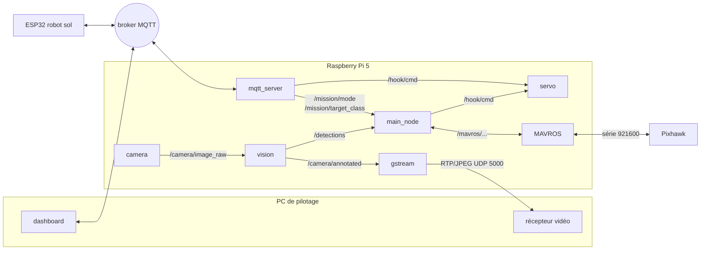

# Architecture ROS 2 du drone

Le code embarqué est découpé en **nœuds ROS 2** (Jazzy) qui échangent des messages sur des topics. Le lien avec la Pixhawk passe par **MAVROS**, et celui avec le PC de pilotage et le robot sol (ESP32) par **MQTT**, qui garde le protocole de 2026. Le même code tourne sur la Pi et dans la simulation : seules les sources de quelques topics changent (voir [simulation.md](simulation.md)).

## Paquets

Tout est dans `drone/`, qui est un workspace colcon avec un paquet par rôle :

```
drone/
├── droneload_bringup/            # lancement et paramètres (sans code)
│   ├── launch/drone.launch.py    # lance tout
│   ├── launch/mavros.launch.py   # MAVROS, seule configuration (drone et simu)
│   └── config/drone.yaml         # paramètres de chaque nœud
├── droneload_vol/
│   └── droneload_vol/
│       ├── main_node.py          # nœud principal : modes, appel des missions
│       ├── mavros.py             # MavrosDrone : commandes et état de l'autopilote, sans bloquer
│       └── missions/             # décollage, atterrissage, épreuve 1, épreuve 2
├── droneload_vision/
│   └── droneload_vision/
│       ├── camera.py             # caméra Module 3 (Pi seulement)
│       ├── vision.py             # détection YOLO
│       └── gstream.py            # flux vidéo vers le PC
└── droneload_hardware/
    └── droneload_hardware/
        ├── servo.py              # servo du crochet (GPIO 13)
        └── mqtt_server.py        # dashboard et ESP32 (MQTT)
```

Chaque paquet contient aussi `package.xml` (dépendances ROS), `setup.py` (liste des nœuds exécutables) et `setup.cfg`. Le code se trouve dans `<paquet>/<paquet>/`, car ament_python impose ce double niveau.

## Nœuds et topics



| Topic | Type | Publié par | Lu par |
|---|---|---|---|
| `/camera/image_raw` | `sensor_msgs/Image` | `camera` (Pi), `bridge` (simu) | `vision` |
| `/camera/camera_info` | `sensor_msgs/CameraInfo` : calibration (`config/camera/module3_640x480.yaml` sur la Pi, caméra Gazebo de même focale en simu) | `camera` (Pi), `bridge` (simu) | (ArUco, #15) |
| `/detections` | `vision_msgs/Detection2DArray` (`class_id` = nom de la classe) | `vision` | `main_node`, `mqtt_server` (FPS) |
| `/camera/annotated` | `sensor_msgs/Image` | `vision` | `gstream` |
| `/mission/mode` | `std_msgs/String` : `attente`, `takeoff`, `land`, `epreuve1`, `epreuve2` | `mqtt_server` | `main_node` |
| `/mission/target_class` | `std_msgs/String` | `mqtt_server` | `main_node`, `vision` |
| `/mission/state` | `std_msgs/String` : `<mode>:<état>`, par ex. `takeoff:MONTEE` | `main_node` | (journal, Foxglove) |
| `/hook/cmd` | `std_msgs/Bool` (true = ouvert) | `mqtt_server`, `main_node` | `servo` |
| `/mavros/state`, `/mavros/rangefinder/rangefinder` | MAVROS | MAVROS | `main_node` |
| `/mavros/battery` | `sensor_msgs/BatteryState` | MAVROS | `mqtt_server` |

`/mission/mode`, `/mission/target_class` et `/mission/state` sont en QoS *transient local* : un nœud qui (re)démarre reçoit la dernière valeur. Les images et les détections sont en QoS capteur (*best effort*, la dernière seulement).

Commandes de l'autopilote, toutes envoyées par `MavrosDrone` sans attendre la réponse :

| Action | MAVROS |
|---|---|
| mode GUIDED / LAND | service `/mavros/set_mode` |
| armement, désarmement | service `/mavros/cmd/arming` |
| décollage | service `/mavros/cmd/takeoff` |
| vitesse dans le repère du drone | topic `/mavros/setpoint_raw/local`, `FRAME_BODY_NED` |
| origine EKF (sans GPS, requise par GUIDED) | topic `/mavros/global_position/set_gp_origin` |
| flux lidar (RANGEFINDER) et batterie (SYS_STATUS), pas envoyés par défaut par ArduPilot | service `/mavros/set_message_interval` |

L'altitude utilisée par les missions est la distance lidar brute du MTF-01 (`/mavros/rangefinder/rangefinder`).

## Nœud principal et missions

`main_node` tourne à 20 Hz. À chaque tick, il fait avancer d'un pas la mission du mode courant :

| Mode | Mission | États |
|---|---|---|
| `attente` | vol stationnaire (vitesse nulle, seulement si le drone est armé en GUIDED) | `ATTENTE` |
| `takeoff` | `Decollage` : GUIDED, armement, décollage à 1 m, stationnaire | `GUIDED` → `ARMEMENT` → `MONTEE` → `STATIONNAIRE` (ou `ECHEC`) |
| `land` | `Atterrissage` : mode LAND jusqu'au désarmement | `LAND` → `DESCENTE` → `POSE` |
| `epreuve1` | `Epreuve1` : cible validée si seule la classe demandée est détectée sur ≥ 80 % des images en 2 s, puis le crochet s'ouvre | `RECHERCHE` → `TROUVEE` |
| `epreuve2` | `run_epreuve2` : se tourne vers la vache et avance tant qu'elle est centrée | `SUIVI` |

Une mission ne bloque jamais : elle envoie une demande, puis vérifie le résultat aux ticks suivants. Elle réessaie toutes les secondes si la demande est refusée. À chaque changement de mode, les missions sont remises à zéro.

## Protocole MQTT

Il est inchangé depuis 2026 : `ground/dashboard.py` et l'ESP32 n'ont rien à modifier.

| Topic | Sens | Contenu |
|---|---|---|
| `drone/cmd` | PC → drone | JSON `{"action": ...}` : `set_mode` (`mode`), `set_class` (`class_name`), `set_hook` (`state` : `hook_open` / `hook_close`), `arm`, `disarm` |
| `drone/system` | PC → drone | `reboot`, `restart_script`, `shutdown` |
| `drone/logs` | drone → PC | texte : messages de `mqtt_server` et logs des autres nœuds |
| `drone/telemetry` | drone → PC | JSON chaque seconde : `fps` (images analysées par la vision), `cpu_percent`, `ram_percent`, `flight_time_sec`, `mode`, `batt_v`, `batt_pct`, `esp_connected` |
| `robot/ping` | ESP32 → drone | heartbeat (déconnecté après 4 s sans ping) |

**La commande `arm` arme réellement les moteurs.**

`restart_script` arrête tout le code du drone, qui est relancé par le service qui l'a démarré : Docker en simu (`restart: unless-stopped`), systemd sur la Pi (pas encore en place, voir #13).

## Construire et lancer

On construit depuis `drone/` : les dossiers `build/`, `install/` et `log/` sont créés dans `drone/` et ignorés par git. `--symlink-install` est obligatoire, car le launch retrouve le repo (et `models/`) à partir de son propre fichier.

```bash
cd drone
colcon build --symlink-install
source install/setup.bash          # automatique dans les nouveaux shells (install/ Ansible)

ros2 launch droneload_bringup drone.launch.py                     # drone réel
ros2 launch droneload_bringup drone.launch.py vision_only:=true   # sans Pixhawk
ros2 launch droneload_bringup drone.launch.py sim:=true           # simulation (fait par le service drone)
```

| Argument | Défaut | Rôle |
|---|---|---|
| `sim` | `false` | `true` : MAVROS et images fournis par la simu, crochet simulé, horloge de la simu |
| `vision_only` | `false` | `true` : pas de MAVROS (test de la vision sans Pixhawk) |
| `pc_ip` | PC de pilotage (réel), `host.docker.internal` (simu) | destination du flux vidéo |
| `fcu_url` | `/dev/ttyAMA0:921600` | liaison MAVROS → Pixhawk (argument de `mavros.launch.py`) |
| `model` | `models/best_ncnn_model` | modèle YOLO |

Les autres réglages (hauteur de décollage, résolution, broker...) sont dans `drone/droneload_bringup/config/drone.yaml`. La calibration de la caméra est dans `config/camera/module3_640x480.yaml` : la refaire avec `tools/calibration.py` sur la Pi (photos d'un damier), qui réécrit ce fichier. Si la résolution change, il faut une nouvelle calibration (#68).

Ce que lance chaque mode :

| Nœud | Réel | `vision_only` | `sim` |
|---|---|---|---|
| MAVROS (`mavros.launch.py`) | lancé | — | même fichier, lancé par le service `mavros` de la simu |
| `camera` | lancé | lancé | — (le `bridge` publie les images) |
| `servo` | GPIO | GPIO | mock (journal seulement) |
| `main_node`, `vision`, `gstream`, `mqtt_server` | lancés | lancés | lancés |

## Ajouter un nœud

1. Ajouter le fichier dans le paquet du bon rôle, avec une fonction `main()`.
2. Le déclarer dans `entry_points` du `setup.py` du paquet, et ses dépendances dans `package.xml` (et dans `install/packages.yml` si c'est un paquet apt ou pip).
3. L'ajouter dans `drone.launch.py`, et ses paramètres dans `drone.yaml`.
4. Documenter ses topics dans le tableau ci-dessus.

Pour un message, utiliser d'abord un type standard (`std_msgs`, `sensor_msgs`, `geometry_msgs`, `vision_msgs`). Ne créer un paquet de messages que si aucun type standard ne convient.

## À venir

| Brique | Issue | Point d'entrée |
|---|---|---|
| Calibration de la caméra basse (distorsion) | #68 | `tools/calibration.py` sur la Pi, réécrit `config/camera/module3_640x480.yaml` |
| ArUco et pose 3D (caméra basse) | #15 | nouveau nœud dans `droneload_vision`, sur `/camera/image_raw` et `/camera/camera_info` |
| Compensation de l'inclinaison de la caméra | #69 | positions des détections corrigées avec l'attitude (`/mavros/imu/data`), repère horizontal (tf2) |
| AI HAT (Hailo) | #27 | backend `hailo` de `vision.py` (paramètre `backend`) |
| Caméra de profondeur | #28, #34 | `realsense2_camera` sur `/stereo/...`, puis remplacer `DISTANCE_AVANT` de l'épreuve 2 |
| UWB | #17, #24 | nœud qui publie `/uwb/pose` et l'envoie à `/mavros/vision_pose/pose` |
| Étapes avec validation de l'opérateur | #29 | remplace les missions de `droneload_vol` |

## Migration depuis le code 2026

Le code 2026 (une seule boucle Python cadencée par la caméra, pymavlink) a été entièrement remplacé. Il reste disponible dans l'historique git (dernier commit avant la migration : `3c65685`).

| Ancien fichier | Décision | Devenu |
|---|---|---|
| `main.py` (boucle unique) | réécrit | `main_node.py` : timer à 20 Hz, vision dans son propre nœud |
| `mavlink.py` (`DroneController`, pymavlink) | réécrit | `mavros.py` (`MavrosDrone`) : même rôle, via MAVROS, sans aucune attente bloquante |
| `mavlink.py` (`DummyDroneController`) | jeté | inutile : sans MAVROS (`vision_only`), les commandes sont seulement refusées et journalisées |
| `tasks/epreuve1.py` (`TakeOff`, `Land`) | réécrit | `missions/decollage.py`, `missions/atterrissage.py` : nouvel essai en cas de refus, remise à zéro |
| `tasks/epreuve1.py` (`Epreuve1Task`) | gardé (règle des 80 % sur 2 s) | `missions/epreuve1.py` (décision) + `vision.py` (inférence et dessin) |
| `tasks/epreuve2.py` | gardé | `missions/epreuve2.py`, qui reçoit maintenant les vraies détections |
| `video.py` | découpé | `camera.py` (entrée libcamera) + `gstream.py` (sortie vers le PC) |
| `hardware.py` | gardé pour le crochet | `servo.py` ; le servo caméra disparaît (caméra fixe vers le sol) |
| `mqtt_server.py` | gardé (même protocole) | `mqtt_server.py` du paquet `droneload_hardware` ; arm/disarm et batterie via MAVROS |
| `config.py` | remplacé | `drone.yaml` + arguments de `drone.launch.py` |
| `vision/aruco.py` | mis de côté | repris dans #15 (pose 3D) |

Bugs de 2026 corrigés au passage :
- `TakeOff` et `Land` n'étaient jamais réinitialisées, donc une 2e demande ne faisait rien. Les missions sont désormais remises à zéro à chaque changement de mode.
- La fenêtre de détection de l'épreuve 1 n'était jamais réinitialisée. Elle l'est maintenant au changement de mode et au changement de cible.
- L'épreuve 2 ne recevait aucune détection.
- `arm_and_takeoff_guided2` bloquait la boucle pendant le changement de mode et l'armement.
