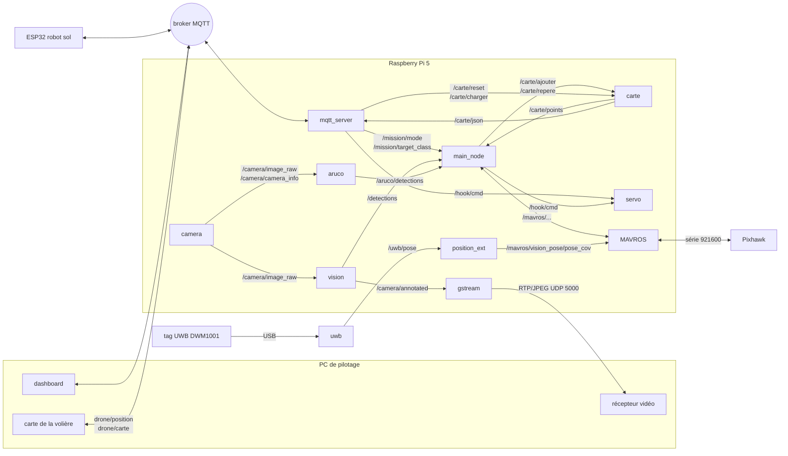

# Architecture ROS 2 du drone

Le code embarqué est découpé en **nœuds ROS 2** (Jazzy) qui échangent des messages sur des topics. Le lien avec la Pixhawk passe par **MAVROS**, et celui avec le PC de pilotage et le robot sol (ESP32) par **MQTT**, qui garde le protocole de 2026. Le même code tourne sur la Pi et dans la simulation : seules les sources de quelques topics changent (voir [simulation.md](simulation.md)).

## Paquets

Tout est dans `drone/`, qui est un workspace colcon avec un paquet par rôle :

```
drone/                            # workspace colcon (build/, install/, log/ créés ici)
└── src/                          # code source : un dossier par paquet
    ├── droneload_bringup/            # lancement et paramètres (sans code)
    │   ├── launch/drone.launch.py    # lance tout
    │   ├── launch/mavros.launch.py   # MAVROS, seule configuration (drone et simu)
    │   └── config/drone.yaml         # paramètres de chaque nœud
    ├── droneload_vol/
    │   └── droneload_vol/
    │       ├── main_node.py          # nœud principal : modes, appel des missions
    │       ├── mavros.py             # MavrosDrone : commandes et état de l'autopilote, sans bloquer
    │       ├── carte.py              # nœud carte : registre des points enregistrés par les missions, sauvegarde
    │       ├── carte_client.py       # accès des missions à la carte, ce que voit la caméra dans le repère map
    │       ├── reperes.py            # changements de repère (caméra -> map, fenêtre par ses ArUco), sans ROS
    │       └── missions/             # décollage, atterrissage, déplacement, relevé, épreuve 1, épreuve 2
    ├── droneload_vision/             # traitement d'image seulement (aucun matériel, testable partout)
    │   └── droneload_vision/
    │       ├── vision.py             # détection YOLO
    │       └── aruco.py              # ArUco : identifiant et pose 3D (calibration de /camera/camera_info)
    └── droneload_hardware/           # entrées/sorties du drone : capteurs, actionneurs, liaisons au sol
        └── droneload_hardware/
            ├── camera.py             # caméra Module 3 (Pi seulement)
            ├── servo.py              # servo du crochet (GPIO 13)
            ├── gstream.py            # flux vidéo vers le PC
            ├── mqtt_server.py        # dashboard et ESP32 (MQTT)
            ├── position_ext.py       # position UWB -> Pixhawk (position externe)
            ├── uwb.py                # tag UWB DWM1001 en USB -> /uwb/pose
            └── uwb_tlv.py            # API binaire TLV du firmware PANS (sans ROS)
```

Chaque paquet contient aussi `package.xml` (dépendances ROS), `setup.py` (liste des nœuds exécutables) et `setup.cfg`. Les paquets sont dans `drone/src/` (disposition standard d'un workspace colcon) et le code se trouve dans `drone/src/<paquet>/<paquet>/`, car ament_python impose ce double niveau.

## Nœuds et topics



| Topic | Type | Publié par | Lu par |
|---|---|---|---|
| `/camera/image_raw` | `sensor_msgs/Image` | `camera` (Pi, `libcamerasrc` ; à valider : la libcamera d'Ubuntu 24.04 ne gère pas le Pi 5, essai de `camera_ros` en cours), `bridge` (simu) | `vision`, `aruco` |
| `/camera/camera_info` | `sensor_msgs/CameraInfo` : calibration (`config/camera/module3_640x480.yaml` sur la Pi, caméra Gazebo de même focale en simu) | `camera` (Pi), `bridge` (simu) | `aruco` |
| `/detections` | `vision_msgs/Detection2DArray` (`class_id` = nom de la classe) | `vision` | `main_node`, `mqtt_server` (FPS) |
| `/camera/annotated` | `sensor_msgs/Image` | `vision` | `gstream` |
| `/aruco/detections` | `vision_msgs/Detection3DArray` : un `Detection3D` par marqueur, `class_id` = identifiant, `results[0].pose.pose` = pose du marqueur en m dans le repère optique de la caméra (x à droite, y vers le bas, z dans l'axe : la distance au sol quand le drone est à plat) | `aruco` | `main_node` (`carte_client.py`, missions) |
| `/aruco/annotated` | `sensor_msgs/Image` : marqueurs, axes et position en cm (débogage, Foxglove) | `aruco` | — |
| `/mission/mode` | `std_msgs/String` : `attente`, `takeoff`, `land`, `epreuve1`, `epreuve2` | `mqtt_server` | `main_node` |
| `/mission/target_class` | `std_msgs/String` | `mqtt_server` | `main_node`, `vision` |
| `/mission/target_point` | `geometry_msgs/Point` : point visé par la mission `deplacement` (x, y en m, repère `map` de l'EKF) | `mqtt_server` | `main_node` |
| `/mission/state` | `std_msgs/String` : `<mode>:<état>`, par ex. `takeoff:MONTEE` | `main_node` | (journal, Foxglove) |
| `/hook/cmd` | `std_msgs/Bool` (true = ouvert) | `mqtt_server`, `main_node` | `servo` |
| `/hook/ready` | `std_msgs/Bool`, chaque seconde : true si le crochet est utilisable (GPIO ouvert, ou mock) | `servo` | `mqtt_server` |
| `/mavros/state`, `/mavros/rangefinder/rangefinder` | MAVROS | MAVROS | `main_node` |
| `/mavros/battery` | `sensor_msgs/BatteryState` | MAVROS | `mqtt_server` |
| `/mavros/local_position/pose` | `geometry_msgs/PoseStamped` : position et attitude estimées par l'EKF, repère `map` (ENU ; origine au départ du drone sans UWB, repère des ancres avec), 10 Hz | MAVROS (LOCAL_POSITION_NED + ATTITUDE_QUATERNION, demandés par `MavrosDrone`) | `main_node` (position des missions, carte), `mqtt_server` (`drone/position`) |
| `/carte/points` | `visualization_msgs/MarkerArray`, repère `map`, chaque seconde et à chaque changement, *transient local* : un marqueur par point, `ns` = type (`aruco`, `robot`, `fenetre`, `obstacle`, `image`, `cible`...), `id` = numéro stable, `text` = JSON `{"nom", "vues", "age", "cap"}` (`age` : s depuis la dernière vue ; `cap` : le point a-t-il une orientation), orientation = cap (fenêtre : normale côté recto), `scale` = taille ; commence par un `DELETEALL` (affichable dans Foxglove) | `carte` | `main_node` (missions) |
| `/carte/json` | `std_msgs/String`, *transient local*, publié avec `/carte/points` : les mêmes points au format de `drone/carte` (JSON prêt pour le PC) | `carte` | `mqtt_server` (`drone/carte`, relayé tel quel) |
| `/carte/ajouter` | `visualization_msgs/Marker` : une vue d'un point, `ns` = type, `text` = nom, pose = position (+ cap ; orientation nulle = sans cap) ; `DELETE` retire le point | `main_node` (`carte.ajouter`) | `carte` |
| `/carte/repere` | `std_msgs/String`, *transient local* : repère de l'EKF (`uwb`, `gps`, `flux` ; source figée à l'armement, au sol celle d'`EK3_SRC1_POSXY`), gardé dans le fichier de la carte | `main_node` | `carte`, `mqtt_server` (`drone/position`) |
| `/position/fiable` | `std_msgs/Bool`, à chaque tick (20 Hz) : position jugée fiable (`get_position()` non `None`, même critère que la pause des missions) | `main_node` | `carte` (refuse les points sinon), `mqtt_server` (`position_fiable`) |
| `/carte/reset`, `/carte/charger` | `std_msgs/Empty` : vide la carte ; reprend la carte du lancement précédent | `mqtt_server` (`reset_carte`, `charger_carte`) | `carte` |
| `/uwb/pose` | `geometry_msgs/PoseWithCovarianceStamped` : position du tag UWB dans le repère des ancres, 10 Hz, orientation à l'identité (PANS ne donne pas de cap) | `uwb` (Pi), service `uwb` (simu, `sim/scripts/uwb_sim.py`) | `position_ext`, `mqtt_server` (`uwb_hz`) |
| `/mavros/vision_pose/pose_cov` | `geometry_msgs/PoseWithCovarianceStamped`, repère `map` (ENU) | `position_ext` | MAVROS → `VISION_POSITION_ESTIMATE` (EKF, `uwb.param`) |
| `/sim/drone/pose` | `geometry_msgs/PoseStamped` : vérité terrain Gazebo (ENU), simu seulement, jamais utilisée pour voler | `bridge` | service `uwb`, `tests/simu/uwb.py`, `mqtt_server` (relayée au PC pour l'affichage, `drone/position`) |

`/mission/mode`, `/mission/target_class`, `/mission/target_point` et `/mission/state` sont en QoS *transient local* : un nœud qui (re)démarre reçoit la dernière valeur. Les images et les détections sont publiées en QoS capteur (*best effort*, file de 5). `vision` et `aruco` s'abonnent à `/camera/image_raw` avec une file d'une seule image (`LATEST_IMAGE`) : quand le traitement est plus lent que la caméra, ils reçoivent la plus récente et non la plus ancienne des images en attente (mesuré en simu avec les limites de la Pi : détections vieilles de 1,5 s avec la file de 5, 0,45 s avec la file de 1, soit le temps d'inférence).

Commandes de l'autopilote, toutes envoyées par `MavrosDrone` sans attendre la réponse :

| Action | MAVROS |
|---|---|
| mode LAND (seulement depuis GUIDED ; GUIDED ne s'obtient que par la radio, voir « Radio et Pi ») | service `/mavros/set_mode` |
| armement, désarmement | service `/mavros/cmd/arming` |
| décollage | service `/mavros/cmd/takeoff` |
| vitesse dans le repère du drone | topic `/mavros/setpoint_raw/local`, `FRAME_BODY_NED` |
| vitesse dans le repère de l'EKF (mission `deplacement`) | topic `/mavros/setpoint_raw/local`, `FRAME_LOCAL_NED` (MAVROS convertit l'ENU) |
| origine EKF (sans GPS, requise par GUIDED) | topic `/mavros/global_position/set_gp_origin` |
| flux lidar (RANGEFINDER), batterie (SYS_STATUS), position EKF (LOCAL_POSITION_NED, ATTITUDE_QUATERNION), pas envoyés par défaut par ArduPilot ; redemandés si le lidar se tait 1 s (autopilote redémarré) | service `/mavros/set_message_interval` |

L'altitude utilisée par les missions est la distance lidar brute du MTF-01 (`/mavros/rangefinder/rangefinder`). `get_current_alt_brute()` renvoie `None` si la dernière mesure a plus de 0,5 s ou sort de la plage du lidar (non finie, hors de 0,01 à 8 m, les bornes `RNGFND1_MIN/MAX` de `config/ardupilot/pixhawk.param`) : une mission ne doit jamais deviner une hauteur, elle attend ou s'arrête. (La Pixhawk, elle, lit le lidar directement et tient sa hauteur même si la Pi ne reçoit plus le flux.)

Même règle pour la position : `get_position()` renvoie la position de l'EKF (x, y en m, repère `map`, ENU, `/mavros/local_position/pose`) ou `None` si elle n'est pas fiable : position EKF vieille de plus de 0,5 s, ou **source absolue présente à l'armement qui s'est tue**. La source est celle qu'utilise l'EKF, d'après `EK3_SRC1_POSXY` lu par MAVROS (`/mavros/param/get_parameters`) : 6 = UWB, 3 = GPS (ou Marvelmind sur GPS1), autre = flux optique seul (position relative au départ, jugée fiable). Elle est figée à l'armement et journalisée (« Position : UWB / GPS / flux optique seul »). Surveillance : UWB tant que `position_ext` envoie la position (`/mavros/vision_pose/pose_cov` de moins de `delai_source`, 1 s), GPS tant qu'un fix 3D arrive (moins de 3 s). Le paramètre compte, pas les mesures reçues : sans `uwb.param`, `position_ext` envoie l'UWB que l'EKF ignore (`VISO_TYPE` 0), et sa perte ne doit pas arrêter une mission (vu en simu). Limite : seul le jeu de sources 1 est lu ; après une bascule sur le jeu 2 au switch RC9, la Pi croit toujours voler sur la source du jeu 1. Pendant une perte d'UWB, la Pixhawk continue au flux optique : la position de l'EKF existe toujours mais dérive, d'où ce jugement côté Pi.

## Nœud principal et missions

`main_node` tourne à 20 Hz. À chaque tick, il fait avancer d'un pas la mission du mode courant :

| Mode | Mission | États |
|---|---|---|
| `attente` | vol stationnaire (vitesse nulle, seulement si le drone est armé en GUIDED) | `ATTENTE` |
| `takeoff` | `Decollage` : attend que le pilote passe en GUIDED à la radio (sans limite de temps), arme, décolle à 1 m (ordre renvoyé toutes les 5 s tant que le drone est sous 0,3 m), stationnaire ; autopilote sorti de GUIDED avant l'armement : retour en attente, jamais d'armement hors GUIDED ; `ECHEC` si l'armement est refusé 60 s (kill actif, pré-armements) ou si la hauteur n'est pas atteinte en 30 s (le drone reste en stationnaire, l'opérateur fait `land`) | `ATTENTE_GUIDED` → `ARMEMENT` → `MONTEE` → `STATIONNAIRE` (ou `ECHEC`) |
| `land` | `Atterrissage` : mode LAND jusqu'au désarmement, seulement depuis GUIDED ; dans un autre mode, le pilote a la main : `REFUSE`, rien n'est envoyé ; drone déjà désarmé : `POSE` | `LAND` → `DESCENTE` → `POSE` (ou `REFUSE`) |
| `epreuve1` | `Epreuve1` (drone en stationnaire) : cible validée si seule la classe demandée est détectée sur ≥ 80 % des images en 2 s, puis le crochet s'ouvre ; `SANS_VISION` (signalé) si aucune image analysée sur une fenêtre de 2 s, retour en `RECHERCHE` quand les images reviennent | `RECHERCHE` → `TROUVEE` (ou `SANS_VISION`) |
| `epreuve2` | `run_epreuve2` : se tourne vers la vache et avance tant qu'elle est centrée | `SUIVI` |
| `deplacement` | `Deplacement` : va au point visé (`set_point`, repère de l'EKF) à hauteur constante, vitesse `min(vitesse_max, distance)` (0,5 m/s au plus), puis stationnaire ; hauteur lidar inconnue : stationnaire, `ECHEC` si elle le reste plus de 2 s (`HAUTEUR_DELAI`). Mission qui a besoin de la position (voir ci-dessous) | `SANS_POINT`, `EN_ROUTE` → `ARRIVE` (ou `ECHEC`, `POSITION_PERDUE`, `ABANDON`) |
| `releve` | `Releve` : enregistre sur la carte tout ce que voit la caméra sol (section « Carte de la volière »), en stationnaire, ou vers un point envoyé par `set_point` pendant le relevé (point oublié à chaque entrée dans le mode). Besoin de la position | `STATIONNAIRE`, puis ceux de `deplacement` |

Une mission ne bloque jamais : elle envoie une demande, puis vérifie le résultat aux ticks suivants. Elle réessaie toutes les secondes si la demande est refusée. À chaque demande de mode, même identique au mode en cours (relancer un `takeoff` en `ECHEC`), les missions sont remises à zéro et, sauf en `takeoff`, une vitesse nulle est envoyée tout de suite : sinon ArduPilot garderait la consigne de vitesse du mode précédent jusqu'à `GUID_TIMEOUT`. Une erreur dans une mission est journalisée et met le drone en stationnaire, sans arrêter le nœud.

**Perte de position.** Une mission qui a besoin de la position (`besoin_position = True` : `deplacement`, et plus tard les missions 2027 qui visent la fenêtre, une zone ou le retour) n'est pas appelée tant que `get_position()` vaut `None` : le drone reste en stationnaire (la Pixhawk vole au flux optique) et l'état est `<mode>:POSITION_PERDUE`. Au retour de l'UWB, `get_position()` reste à `None` encore `delai_recalage` (3 s), le temps que l'EKF se recale : une mission ne repart pas sur une position encore fausse, et la carte n'enregistre rien pendant ce temps (même critère, `/position/fiable`). Si la position revient dans les `delai_position` (30 s, temps de simulation en simu), la mission reprend où elle était. Au-delà : `<mode>:ABANDON`, le drone reste en stationnaire jusqu'à une nouvelle demande de mode (`land`, `attente`, ou la mission à relancer) ou jusqu'à la reprise en main par le pilote à la radio (exigée à tout moment par le règlement) ; la mission ne repart pas seule, même si la position revient. Les autres modes (`takeoff`, `land`, `attente`, `epreuve1`, `epreuve2`) n'utilisent pas la position. **Reprise en main par le pilote.** Si l'autopilote quitte GUIDED pendant une mission (pilote à la radio), `main_node` passe en `attente` (« Reprise en main par le pilote » sur `drone/logs`) ; revenu en GUIDED, le drone reste en stationnaire, la mission ne repart pas seule. Sauf en `takeoff` (qui passe lui-même en GUIDED) et `land` (mode LAND). Les consignes de vitesse (`send_velocity_local`, `send_velocity_body`, `hover`) ne partent que drone armé en GUIDED. Côté ArduPilot, rien ne change : `FS_EKF_ACTION 1` fait atterrir si l'EKF lui-même est perdu (plus de flux optique ni de lidar). Test : `tests/simu/position.py` (pannes, recalage, abandon, reprise en main). `vitesse_max` se change en vol (`ros2 param set /main_node vitesse_max 1.0`), pour les missions `deplacement` et `releve`.

**Ajouter une mission.**
1. Écrire la classe dans `droneload_vol/missions/` (exportée par `missions/__init__.py`) : `reset()`, `state` et `run(drone, now)`, qui ne bloque jamais.
2. Si elle vise des positions : `besoin_position = True`. Dans `run`, `drone.get_position()` n'est alors jamais `None`, et la pause comme l'abandon sont automatiques.
3. Si elle lit ou enregistre des points de la carte : recevoir `self.carte` de `main_node` au constructeur (comme `Releve(log, self.carte, ...)`), et `besoin_position = True` (un point enregistré sans position fiable serait faux).
4. L'enregistrer en une ligne dans la table `self.missions` de `main_node` (mode → mission). Le mode, la remise à zéro et la publication de l'état en découlent.

Exemple : aller à la fenêtre repérée, puis noter l'image cible vue en chemin.

```python
class VersFenetre:
    besoin_position = True

    def __init__(self, log, carte):
        self.log, self.carte = log, carte
        self.reset()

    def reset(self):
        self.state = 'RECHERCHE'

    def run(self, drone, now):
        fenetre = self.carte.get('fenetre')            # None tant qu'aucune mission ne l'a enregistrée
        if fenetre is None:
            drone.send_velocity_local(0, 0, 0)         # on ne devine pas : on attend (ou on cherche)
            return
        self.state = 'EN_ROUTE'
        # ... vitesse vers (fenetre['x'], fenetre['y']), devant le recto : cap fenetre['cap'] (rad)
        for image in self.carte.images_vues():         # ce que voit la caméra sol, repère de la carte
            if image['classe'] == 'pomme':
                self.carte.ajouter('cible', 'pomme', image['position'])
```

et dans `main_node` : `'vers_fenetre': VersFenetre(log, self.carte),` dans `self.missions`.

Pour que la reprise après une pause fonctionne :
- viser des points absolus du repère de l'EKF, calculés une fois et gardés dans la mission, et non des déplacements comptés en temps ;
- prévoir que les délais propres à la mission continuent de courir pendant la pause.

La carte suit le même critère : `main_node` le publie sur `/position/fiable`, et le nœud `carte` refuse tout point enregistré sans position fiable (section « Carte de la volière »). La mission `releve` a en plus `besoin_position`, pour se mettre en pause comme les autres.

## Protocole MQTT

Celui de 2026, complété pour la carte de la volière (`drone/position`, `drone/carte`, `reset_carte`, `charger_carte`) : l'ESP32 n'a rien à modifier.

| Topic | Sens | Contenu |
|---|---|---|
| `drone/cmd` | PC → drone | JSON `{"action": ...}` : `set_mode` (`mode`), `set_class` (`class_name`), `set_point` (`x`, `y` en m, repère de l'EKF : point de la mission `deplacement`, ou de `releve` s'il est envoyé pendant le relevé ; pour les essais, le règlement compte un point donné par l'opérateur comme action manuelle), `set_hook` (`state` : `hook_open` / `hook_close`), `arm`, `disarm`, `reset_carte` (vide la carte), `charger_carte` (reprend la carte du lancement précédent) |
| `drone/system` | PC → drone | `reboot`, `restart_script`, `shutdown`, `reboot_fcu` (redémarre la Pixhawk : `MAV_CMD_PREFLIGHT_REBOOT_SHUTDOWN` par `/mavros/cmd/command`) ; refusés si le drone est armé |
| `drone/logs` | drone → PC | texte : messages de `mqtt_server` et logs des autres nœuds |
| `drone/telemetry` | drone → PC | JSON chaque seconde : `fps` (images analysées par la vision), `cam_fps` (images de la caméra, comptées sur `/camera/camera_info`), `hook_ready` (crochet utilisable ; `false` aussi si `servo` ne publie plus depuis 2,5 s, `null` si jamais reçu), `cpu_percent`, `cpu_temp` (°C ou `null`), `undervoltage` (alarme de sous-tension de la Pi 5, `null` ailleurs ; chaque passage est signalé sur `drone/logs` et compté dans le bilan de démarrage), `ram_percent`, `flight_time_sec` (temps armé du vol en cours, sinon du dernier vol ; « Vol terminé » sur `drone/logs` au désarmement), `mode` (dernier mode demandé), `mission` (état réel de `main_node`, ex. `takeoff:MONTEE`), `fcu_connected`, `fcu_mode`, `armed` (MAVROS), `position_fiable` (`/position/fiable`, `null` si `main_node` se tait ; colonne POS du dashboard), `height` (lidar en m, `null` sans mesure depuis 1 s), `batt_v`, `batt_pct`, `esp_connected`, `uwb_hz` (mesures `/uwb/pose` par seconde, 0 sans UWB) |
| `drone/position` | drone → PC | JSON à 5 Hz : `ekf` (`x`, `y`, `z` en m et `cap` en degrés, 0 = axe x, sens trigo, repère `map` de `/mavros/local_position/pose`) et `verite` (même format, `/sim/drone/pose`, simu seulement), `repere` (`/carte/repere`, `null` tant qu'inconnu), chacun `null` sans donnée depuis 1 s |
| `drone/carte` | drone → PC | JSON *retained* chaque seconde : `/carte/json` du nœud `carte` relayé tel quel, liste des points `{"type", "nom", "x", "y", "z", "cap", "vues", "age", "taille"}` (`cap` en degrés, `null` sans orientation ; `age` en s depuis la dernière vue ; `taille` : largeur, hauteur en m), repère `map` |
| `robot/ping` | ESP32 → drone | heartbeat (déconnecté après 4 s sans ping) |

**La commande `arm` arme réellement les moteurs.**

Un message mal formé (non JSON, champ manquant ou invalide) est signalé sur `drone/logs` et ignoré.

`restart_script` arrête tout le code du drone, qui est relancé par le service qui l'a démarré : Docker en simu (`restart: unless-stopped`), service systemd `droneload` sur la Pi (installé par `install/`, rôle `pi`, démarré au boot, `Restart=always` ; `journalctl -u droneload` pour ses logs). Les nœuds sont relancés seuls par le launch s'ils s'arrêtent (`respawn`, 2 s), `mqtt_server` et MAVROS (`respawn_mavros`) compris : seul `restart_script` (sortie de `mqtt_server` avec le code 3) arrête tout. Un plantage de `mqtt_server` en vol coupe donc la liaison avec le dashboard 2 à 3 s, sans arrêter MAVROS ni la mission en cours.

Bilan de démarrage : 20 s après son lancement, `mqtt_server` envoie deux lignes sur `drone/logs` (Pixhawk et son mode, lidar, batterie ; caméra, vision, crochet, UWB, résultat d'`install/check.py` sur la Pi), ce qui manque en majuscules. La Pixhawk ne redémarre pas avec la Pi (alimentation séparée) : `reboot_fcu` la redémarre, MAVROS se reconnecte seul.

Pannes du matériel, toutes visibles sur le dashboard (concours 2026 : la Pi ne voyait plus la Pixhawk et rien ne le signalait) :
- **double lancement** : `drone.launch.py` prend un verrou (`/tmp/droneload-drone.lock`) et refuse de démarrer si le code tourne déjà (service `droneload` sur la Pi) ;
- **port série de la Pixhawk** absent, inaccessible ou déjà ouvert : MAVROS n'est pas lancé, raison répétée toutes les 10 s sur `drone/logs` (`mavros.launch.py`) ;
- **caméra** impossible à ouvrir (nappe, caméra prise) : `camera` reste lancé, le signale et réessaie toutes les 5 s ; plus d'image pendant 3 s : le nœud s'arrête et le launch le relance (la lecture GStreamer peut bloquer sans fin) ;
- **crochet** : la puce GPIO est cherchée par son nom (`pinctrl-rp1`), pas par son numéro, qui change selon le noyau (une autre puce accepterait la broche 13 sans erreur). GPIO indisponible : `servo` le signale, réessaie toutes les 5 s, publie `/hook/ready` à false et refuse les commandes (pas d'ouverture différée, le drone aurait bougé).

## Carte de la volière

Les missions enregistrent et relisent des points (ArUco, robot, fenêtre, obstacles, images cibles...) dans le repère `map` de l'EKF. Le nœud `carte` (`droneload_vol`) n'est qu'un registre : il ne regarde aucune caméra, ce sont les missions qui décident quoi enregistrer.

```
/aruco/detections, /detections ─┐  main_node : self.carte (carte_client.py)      missions :
/mavros/local_position/pose ────┴─► caméra -> map (reperes.py)            ─────► carte.get / liste / ajouter
                                    /carte/ajouter ▼   ▲ /carte/points           carte.arucos_vus / images_vues
                                               nœud carte ──► donnees/carte.json
```

- **Lire** : `self.carte.get('aruco', '0')` → `{'type', 'nom', 'x', 'y', 'z', 'cap', 'vues', 'age'}` ou `None` (point absent : la mission attend ou cherche, elle ne devine pas) ; `get('fenetre')` : premier point du type ; `liste('image')` : tous.
- **Enregistrer** : `self.carte.ajouter(type, nom, (x, y, z), cap=None)`, une vue par appel. Types de `remplacer` (`robot` qui bouge, `cible` notée une fois par une mission) : dernière vue seule, publiés dès la 1re ; autres : moyenne, publiés à partir de `vues_min` (3) vues, vue à plus de `ecart_max` (0,5 m) de la moyenne rejetée après 6 vues (`2 × vues_min`). Conséquence : un point dont les premières vues étaient fausses (pose ambiguë, reflet) est figé et ne se corrige plus seul ; le retirer (`retirer(type, nom)`) ou vider la carte (`reset_carte`, touche E du dashboard) pour le refaire. `retirer(type, nom)`.
- **Ce que voit la caméra sol**, déjà dans le repère `map` : `arucos_vus()` (position, normale de la face imprimée), `images_vues()` (centre du cadre YOLO projeté au sol avec la hauteur lidar) ; `enregistrer_vus()` enregistre tout, une fois par image : ArUco de la fenêtre → `fenetre`, ArUco 1 → `robot`, autres → `aruco`, objets YOLO → `image` (nom = classe). C'est ce que fait la mission `releve` (stationnaire, ou vers un point envoyé par `set_point` pendant le relevé ; le point est oublié à chaque entrée dans le mode). Passage optique → drone : caméra vers le sol, **haut de l'image vers l'avant** (`camera_sol_rotation`, `camera_sol_position`), puis → `map` avec la position et l'attitude de l'EKF (tangage et roulis compensés). Détection ignorée si la position a plus de 0,2 s ou le marqueur plus de 4 m. Réglages : bloc `main_node` de `drone.yaml`.
- **Fenêtre** (taille connue, `fenetre_taille`) : position du centre de l'ouverture et cap de sa normale côté recto, déduits d'un seul de ses ArUco (normale de sa face, retournée pour le verso, et décalage `fenetre_arucos` : `"id face u v"` depuis le centre, u horizontal vers la droite vu du recto, v vers le haut, mêmes axes vus du verso). Fenêtre supposée verticale. Décalages repris de la volière 2027 simulée, **à vérifier sur le règlement** ; aucune caméra du drone ne voit encore la fenêtre (verticale), le calcul est testé par `tests/unitaires/test_reperes.py`.
- **Sauvegarde** : `donnees/carte.json` (`carte_sim.json` en simu, ignorés par git), réécrit à chaque changement avec le repère de l'EKF (`uwb`, `gps` ou `flux`). Au démarrage, par défaut, la carte part vide et l'ancienne est mise de côté (`carte_precedente.json`) : commande `charger_carte` (touche K du dashboard) pour la reprendre, par exemple après un changement de batterie ; `drone.launch.py garder_carte:=true` la reprend dès le démarrage. Sans UWB, l'origine de l'EKF est le point de décollage : une carte d'un autre vol n'est juste que si le drone est reparti du même endroit avec le même cap (avertissement au chargement).

- **Position fiable** : le nœud `carte` refuse tout point (quel que soit le nœud qui l'envoie : `main_node`, plus tard la caméra avant) si `/position/fiable` dit faux (critère de `get_position()`, recalage de 3 s après le retour de l'UWB compris) ou a plus de `age_fiable_max` (0,5 s). Refus et reprise signalés sur `drone/logs`.
- **Un seul repère par carte** : les points sont dans le repère de l'EKF du premier point (`/carte/repere`, publié par `main_node` : `uwb`, `gps`, `flux`). Si le repère de l'EKF change alors que la carte a des points (vol sans UWB après un vol avec), les ajouts sont refusés et signalés jusqu'à `reset_carte`. Sans UWB, une reconnexion de l'autopilote alors que la carte a des points est signalée : si la Pixhawk a redémarré, l'origine de l'EKF a changé et la carte est décalée.
- **Sur le PC**, `ground/carte.py --repere auto` (défaut) suit le repère annoncé par le drone dans `drone/position` (`flux` : position décalée de `--depart`) ; la fenêtre est dessinée à sa taille (`taille` de `drone/carte`). Un nœud hors de `main_node` qui enregistre des points publie sur `/carte/ajouter` (et peut reprendre `reperes.py` pour le changement de repère) : il n'a rien d'autre à vérifier.

La carte ne vaut que ce que vaut l'EKF : sans UWB (flux optique seul), la position est toujours jugée fiable mais dérive. À vérifier sur le vrai drone : orientation de la caméra et `camera_sol_position`.

Sur le PC, `ground/carte.py` (ouvert par `ground/launch.py`) affiche en vue de dessus la volière, le drone (cap, trace des 60 dernières secondes), les points repérés et, en simu, la vérité Gazebo et l'écart à chaque ArUco attendu. Terrain : `--sim` le lit dans `sim/worlds/voliere.sdf` ; en réel, seulement `--taille LxP` (volière centrée) et `--depart x,y`. Sans UWB, l'origine de l'EKF est le départ du drone : la carte décale la position de `--depart` (et la tourne de `--rotation`) ; avec l'UWB, `--repere uwb` l'affiche telle quelle. La fenêtre est dessinée comme un trait de sa largeur, avec une flèche côté recto ; le robot avec l'âge de sa dernière vue. Tests : `tests/simu/carte.py` (mode `releve` en stationnaire, par MQTT seulement ; `--uwb` avec `PARAM_UWB=uwb` : ArUco 0 placé à moins de 8 cm une fois retirée l'erreur de l'EKF, EKF à moins de 30 cm de la vérité), `tests/simu/carte_mouvement.py` (avec l'UWB, dans le conteneur `drone` : passages au-dessus de l'ArUco 0 à 0,5 puis 1 m/s en mode `releve`, carte vidée avant chacun, point à moins de 15 cm ; panne d'UWB et recalage ; changement de repère refusé ; nœud `carte` redémarré : carte vide, `charger_carte` la reprend à l'identique) et `tests/unitaires/test_reperes.py` (changements de repère, fenêtre ; `python3 -m pytest`). À 1 m/s, l'ArUco n'est vu que 2 à 5 fois par passage (champ de ±0,3 m au sol à 1 m de haut, ~12 images/s) : avec `vues_min` = 3, il n'est placé qu'une fois sur deux environ (quand il l'est, à 10 cm au plus). Pour relever des points en vol, passer à 0,5 m/s ou moins, ou voler plus haut.

## Construire et lancer

On construit depuis `drone/` : les dossiers `build/`, `install/` et `log/` sont créés dans `drone/` et ignorés par git. `--symlink-install` est obligatoire, car le launch retrouve le repo (et `models/`) à partir de son propre fichier.

```bash
cd drone
colcon build --symlink-install
source install/setup.bash          # automatique dans les nouveaux shells (install/ Ansible)

ros2 launch droneload_bringup drone.launch.py                     # drone réel
ros2 launch droneload_bringup drone.launch.py vision_only:=true   # sans Pixhawk
ros2 launch droneload_bringup drone.launch.py sim:=true           # simulation (fait par le service drone)
```

| Argument | Défaut | Rôle |
|---|---|---|
| `sim` | `false` | `true` : MAVROS et images fournis par la simu, crochet simulé, horloge de la simu |
| `vision_only` | `false` | `true` : pas de MAVROS (test de la vision sans Pixhawk) |
| `pc_ip` | PC de pilotage (réel), `host.docker.internal` (simu) | destination du flux vidéo |
| `fcu_url` | `/dev/ttyAMA0:921600` | liaison MAVROS → Pixhawk (argument de `mavros.launch.py`) ; sur un port série, MAVROS n'est pas lancé si le port est absent, inaccessible ou déjà ouvert par un autre programme (raison répétée toutes les 10 s sur `drone/logs`, corriger puis `restart_script`) |
| `model` | `models/best_ncnn_model` | modèle YOLO |

Les autres réglages (hauteur de décollage, résolution, broker...) sont dans `drone/src/droneload_bringup/config/drone.yaml`. La calibration de la caméra est dans `config/camera/module3_640x480.yaml` : la refaire avec `tools/calibration.py` sur la Pi (photos d'un damier), qui réécrit ce fichier. Si la résolution change, il faut une nouvelle calibration (#68).

Ce que lance chaque mode :

| Nœud | Réel | `vision_only` | `sim` |
|---|---|---|---|
| MAVROS (`mavros.launch.py`) | lancé | — | même fichier, lancé par le service `mavros` de la simu |
| `camera` | lancé | lancé | — (le `bridge` publie les images) |
| `servo` | GPIO | GPIO | mock (journal seulement) |
| `main_node`, `vision`, `aruco`, `carte`, `gstream`, `mqtt_server` | lancés | lancés | lancés |
| `position_ext` | lancé | — | lancé (`/uwb/pose` vient du service `uwb`) |
| `uwb` (tag UWB) | lancé | lancé | — (service `uwb` de la simu) |

## Ajouter un nœud

1. Ajouter le fichier dans le paquet du bon rôle, avec une fonction `main()` : ce qui touche au matériel ou à une liaison (capteur, actionneur, réseau) va dans `droneload_hardware`, le traitement d'image dans `droneload_vision`, la logique de vol dans `droneload_vol`.
2. Le déclarer dans `entry_points` du `setup.py` du paquet, et ses dépendances dans `package.xml` (et dans `install/packages.yml` si c'est un paquet apt ou pip).
3. L'ajouter dans `drone.launch.py`, et ses paramètres dans `drone.yaml`.
4. Documenter ses topics dans le tableau ci-dessus.

Pour un message, utiliser d'abord un type standard (`std_msgs`, `sensor_msgs`, `geometry_msgs`, `vision_msgs`). Ne créer un paquet de messages que si aucun type standard ne convient.

## Matériel

| Rôle | Référence | Remarque |
|---|---|---|
| Châssis | Tarot FY450 (quadri X) | pieds sous les moteurs, protections d'hélices et support LiPo / Pi / servo imprimés en 3D |
| Moteurs, hélices | Holybro 2216 920 KV, Holybro 1045 autobloquantes | |
| ESC | LANRC 45A BLHeli_S (firmware Bluejay, à confirmer) | DShot bidirectionnel : demande Bluejay, pas le BLHeli_S d'origine |
| Batterie | HRB LiPo 3S 5000 mAh 50C, XT60 | |
| Module d'alimentation | Holybro PM03D (I2C) | alimente la Pixhawk, mesure tension et courant |
| BEC de la Pi | Matek BEC 12S Pro 9-55 V → 5 V 5 A | |
| Contrôleur de vol | Holybro Pixhawk 6C mini | |
| Compas | module M8N livré avec la Pixhawk (LED et bouton de sécurité intégrés) | GPS non utilisé, seul le compas l'est |
| Flux optique + lidar | MicoAir MTF-01P | sur la Pixhawk (TELEM2) |
| Ordinateur de bord | Raspberry Pi 5 (8 ou 16 Go) | |
| Caméra | Raspberry Pi Camera Module 3 standard (75° en diagonale) | fixe, vers le sol ; ~38° × 29° en 640x480 (voir plus bas) |
| Crochet | servo SG90 5 V | GPIO 13 de la Pi |
| Radio | FrSky Taranis X9D Plus 2019 (EdgeTX) + module RadioMaster Ranger Micro, récepteur RadioMaster Nano RP3 (ELRS) | récepteur en MAVLink sur TELEM1 |
| Capteur de distance | Pimoroni VL53L5CX | désactivé, non fonctionnel |

Ports de la Pixhawk : voir plus bas, « Ports ».

**Brochage de la Pi 5** (configuré par le rôle `pi` d'`install/`, rien à faire à la main) :

| Liaison | Broches de la Pi | Côté équipement | Configuration |
|---|---|---|---|
| Pixhawk | GPIO 14 = TX (broche 8), GPIO 15 = RX (broche 10), GND (broche 6) | GPS2 (SERIAL4), TX et RX croisés | `/dev/ttyAMA0` à 921600 ; `dtparam=uart0=on` dans `config.txt`, pas de `console=serial0`/`ttyAMA0` dans les `cmdline.txt`, `serial-getty@ttyAMA0` et ModemManager masqués |
| Servo du crochet | GPIO 13 (broche 33) pour le signal | alimentation par un BEC, **jamais par le 5 V de la Pi** (sous-tension, Pixhawk perdue), masse commune avec la Pi | PWM logiciel lgpio, sans overlay ; groupe `gpio` |
| Caméra Module 3 (imx708) | connecteur CSI (CAM0 ou CAM1, à confirmer) | | `camera_auto_detect=1` ; libcamera prend la première caméra trouvée |
| Console de debug | connecteur UART dédié de la Pi 5 (`/dev/ttyAMA10`) | adaptateur USB-série | laissée active |
| Réseau | eth0 en IP fixe `192.168.2.3/16` (câble direct vers le PC), wifi pour internet | | netplan `60-droneload-eth0.yaml` ; wifi sans économie d'énergie (règle udev) ; noms et mots de passe des wifi saisis au flash, pas dans le repo |

La sous-tension est surveillée : `undervoltage` dans la télémétrie, alerte sur `drone/logs`.

**Positions** (mesurées, drone posé ; repère ArduPilot : X avant, Y droite, Z bas, origine au centre de gravité, estimé à ~18 cm du sol et au centre du châssis, à confirmer) :

| Élément | Mesure | Paramètres |
|---|---|---|
| Plaque supérieure du châssis | 20 cm du sol | |
| LiPo (milieu) | 14 cm du sol | |
| MTF-01P (entre les deux optiques) | 10 cm en arrière du centre (valeurs de la Pixhawk) | `FLOW_POS` = (-0.1, 0, 0), `RNGFND1_POS` = (-0.1, 0, 0.07), `RNGFND1_GNDCLR 0.10` (distance lue drone posé) |
| M8N (milieu) | 6 cm en arrière du centre, 31 cm du sol | compas : aucun paramètre de position ; GPS (config extérieure) : `GPS1_POS_*` encore à 0 dans la Pixhawk |
| Pixhawk (IMU) | supposée au centre | `INS_POS*` à 0 |

**Masse** estimée à ≈ 1,5 kg (1,4 à 1,65 ; à remplacer par une pesée) : châssis ~280 g, moteurs ~240 g, hélices ~50 g, ESC ~50 g, LiPo ~390 g, Pixhawk + M8N ~90 g, PM03D + BEC ~40 g, Pi 5 ~70 g, caméra, capteurs, récepteur, servo ~30 g, pièces imprimées ~200 g, câblage ~40 g. Les moteurs poussent ~0,9 kg chacun en 3S avec des 1045, soit ~3,6 kg au total : rapport poussée/poids ~2,4, stationnaire vers 45 % de gaz (`MOT_THST_HOVER` appris : 0,46 dans une sauvegarde, 0,55 dans la dernière), ~17 A en stationnaire, soit ~14 min de vol sur 80 % de la LiPo. L'iris de la simu (1,6 kg, hélices de 10") en est assez proche pour être gardé.

**Champ de la caméra** : en 640x480, libcamera ne lit qu'une zone centrale du capteur (mode recadré 1536x864, puis découpe en 4:3). L'image couvre donc ~38° × 29° (fx ≈ 938 dans `config/camera/module3_640x480.yaml`) au lieu des 66° × 41° de l'image complète : à 1 m de haut, elle montre ~0,68 × 0,52 m de sol. C'est déduit de la calibration, pas encore vérifié sur la Pi (le mode choisi s'affiche dans les logs de libcamera). La caméra Gazebo a le même champ.

## Pixhawk (ArduCopter)

Un seul fichier de paramètres : `config/ardupilot/pixhawk.param` (format Mission Planner `NOM,VALEUR`, calibrations comprises). C'est la config **extérieure avec GPS** (essais en extérieur). Pour la volière et le concours, la surcouche `config/ardupilot/interieur.param` (une quinzaine de lignes, voir « Intérieur et extérieur ») se charge par-dessus. Le SITL charge `copter.parm` → `pixhawk.param` → surcouche (`PARAM_SURCOUCHE` de `sim/.env`, `interieur` par défaut, vide pour la config GPS) → `sitl.parm`, qui ne remplace que le matériel simulé. Pour que `pixhawk.param` reste la référence :

- changer un paramètre dans le repo : modifier `pixhawk.param`, valider en simu, puis le charger sur la Pixhawk (Mission Planner : *Config > Full Parameter List > Load from file*, puis *Write Params*) ;
- changer un paramètre sur la Pixhawk (calibration, réglage) : réexporter la liste complète par-dessus `pixhawk.param` (*Save to file*), relire le diff, valider en simu.

Firmware : la sauvegarde d'origine (`sauv_finale.param`, dernier état connu de la Pixhawk) venait d'un ArduCopter 4.6.x (paramètres apparus en 4.6, mais anciens noms `RNGFND1_MIN_CM`, `SRn_*`, `PSC_POSXY_*`...). Le fichier a été converti aux noms de Copter-4.7.2 (`ARDUPILOT_TAG` de `sim/.env`) par ArduPilot lui-même : paramètres écrits dans un SITL 4.6.3 puis relus par un SITL 4.7.2 sur la même eeprom (unités converties : vitesses en m/s, angles en degrés, `ARMING_CHECK` devenu `ARMING_SKIPCHK`, `SERIALn_OPTIONS` bit 10 devenu `MAVn_OPTIONS` bit 1). La 4.7 ne convertit pas les débits de flux : les `SRn_*` (canal MAVLink n) ont été recopiés à la main dans `MAV(n+1)_*`. **Flasher Copter-4.7.2 sur la Pixhawk** (avec le firmware « bdshot », DShot bidirectionnel), vérifier après le flash que `MAV1_*`/`MAV2_*` ont gardé leurs débits (sinon plus de télémétrie ELRS), charger `pixhawk.param`, puis réexporter par-dessus.

### Ports (Pixhawk 6C mini)

| Port ArduPilot | Connecteur | Protocole | Débit | Équipement |
|---|---|---|---|---|
| SERIAL0 | USB | MAVLink2 | | PC (Mission Planner, QGC) |
| SERIAL1 | TELEM1 | MAVLink2 | 460800 | récepteur ELRS en mode MAVLink (radiocommande + télémétrie, RSSI par RADIO_STATUS : `RSSI_TYPE 5`) |
| SERIAL2 | TELEM2 | MAVLink1, pas de retransmission (`MAV3_OPTIONS 2`) | 115200 | MTF-01 (flux optique + lidar) |
| SERIAL3 | GPS1 | GPS | 38400 | M8N : compas (I2C, externe, `COMPASS_ORIENT 6` = Yaw270) toujours utilisé ; GPS utilisé en extérieur (`GPS1_TYPE 1`), ignoré en intérieur (`GPS1_TYPE 0`) |
| SERIAL4 | GPS2 (UART8) | MAVLink2 | 921600 | Raspberry Pi (`/dev/ttyAMA0:921600`, `mavros.launch.py`) |

Les paramètres `MAVn_*` (débits de flux, options) sont numérotés par canal MAVLink, dans l'ordre des ports en MAVLink : MAV1 = USB, MAV2 = TELEM1 (ELRS), MAV3 = TELEM2 (MTF-01), MAV4 = GPS2 (Pi). `MAV4_*` sont à 0 : ArduPilot n'envoie à la Pi que le HEARTBEAT et ce qu'elle demande. Le code demande ce dont il a besoin (`STREAMS` de `mavros.py`, service `/mavros/set_message_interval` ; déjà demandés : lidar, batterie, GPS, position locale et attitude) ; tout nouveau topic MAVROS (`/mavros/imu/data` #69...) doit être demandé de la même façon, sinon il reste muet sur le vrai drone. La simu reproduit cela : MAVROS y est sur SERIAL1 (MAV2), dont `sitl.parm` remet les débits à 0.

### Intérieur et extérieur

| | Extérieur (`pixhawk.param`) | Intérieur (+ `interieur.param`) |
|---|---|---|
| GPS | `GPS1_TYPE 1` | `GPS1_TYPE 0` |
| Sources EKF, jeu 1 | GPS (position, vitesse), baromètre (hauteur), compas | flux optique (vitesse), lidar (hauteur), compas, aucune position absolue |
| Jeu 2 (voie RC9) | flux optique + lidar | flux optique + baromètre |
| Modes voie 6 (positions 4 / 6) | Loiter / Guided | FlowHold / Guided |
| Contrôles d'armement | tous (`ARMING_SKIPCHK 0`) | tous sauf GPS (`ARMING_SKIPCHK 1053192`) |
| Origine EKF | donnée par le GPS | fictive, envoyée par `mavros.py` tant que le drone est désarmé |

`mavros.py` choisit seul : il demande `GPS_RAW_INT` et n'envoie l'origine fictive que si l'autopilote n'a aucun GPS : pas de `GPS_RAW_INT` 3 s après la demande (ArduPilot ne l'envoie pas sans GPS configuré ; un message, même `fix_type` 0 au démarrage, veut dire GPS présent) ; avec un GPS, même sans fix, il attend le GPS. L'état est réévalué quand l'autopilote redémarre. En extérieur, GUIDED et l'armement attendent donc le fix GPS. En intérieur, hauteur au lidar plutôt qu'au baromètre : le baromètre dérive (souffle des hélices) et l'altitude de décollage ne correspondrait plus à la hauteur lidar des missions ; en extérieur, la hauteur de l'EKF (donc la cible du décollage GUIDED) vient du baromètre, alors que les missions la vérifient au lidar. Position UWB : voir « UWB » ci-dessous. Lidar : `RNGFND1_TYPE 10` (MAVLink), vers le bas, plage 0,01-8 m (bornes reprises par `LIDAR_MIN/MAX` de `mavros.py`), `RNGFND1_GNDCLR` 0,10 m (distance lue drone posé), positions du flux et du lidar dans `FLOW_POS_*` / `RNGFND1_POS_*` (section Matériel). `ARMING_SKIPCHK` (ex-`ARMING_CHECK`) ne saute que les contrôles GPS : ne jamais désactiver les contrôles d'armement.

### UWB (position externe)

Système principal de position en intérieur (#17, #24) : 6 ancres DWM1001-DEV autour du terrain et un tag sur le drone (firmware PANS de Qorvo), lu par la Pi. La surcouche `config/ardupilot/uwb.param` se charge **par-dessus** `interieur.param`, seulement avec l'UWB installé : avec elle, ArduPilot refuse d'armer sans mesures UWB (« PreArm: VisOdom: not healthy »).

| Jeu de sources (voie RC9) | Position horizontale | Vitesse horizontale | Hauteur | Usage |
|---|---|---|---|---|
| 1 | UWB (`EK3_SRC1_POSXY 6`, ExternalNav) | flux optique, en parallèle | lidar | normal |
| 2 | aucune | flux optique | baromètre (jeu 2 d'`interieur.param`) | panne d'UWB |

Pilote `uwb` : interroge le tag à 20 Hz par l'API binaire TLV de PANS (`dwm_loc_get`, décodée par `uwb_tlv.py`), recommandée par Qorvo pour un programme : contrairement au shell texte (`lep`), elle ne dépend pas de l'état du tag, qui reste alimenté quand le nœud redémarre, et donne aussi les ancres utilisées. Port `/dev/uwb` (lien udev vers le J-Link SEGGER de la carte DEV, rôle `pi` ; `./install/apply.sh` installe aussi `python3-serial`). Un seul lecteur sur le port (deux lecteurs se partagent les octets : panne de 2026) : port non ouvert s'il l'est déjà par un autre programme (cherché dans `/proc`, programme nommé sur `drone/logs`), puis verrouillé par le noyau (`TIOCEXCL`) : toute autre ouverture échoue (« Device or resource busy »), sauf avec `sudo`. Positions de qualité < `qf_min` ou calculées avec moins de `ancres_min` ancres (4 : avec 3 ancres, deux positions sont possibles, symétriques par rapport à leur plan, et le mauvais choix change aussi x, y si les ancres sont à des hauteurs différentes ; 3 seulement si elles sont toutes à la même hauteur) ignorées ; tag absent, occupé ou muet 2 s : signalé sur `drone/logs` et port rouvert ; tag laissé en mode shell : ramené en mode TLV (`quit`). **Non testé sur le vrai tag** : format TLV d'après la documentation de Qorvo, vérifié contre un faux tag (`tests/simu/uwb_pilote.py`) ; l'interrogation ajoute en moyenne 25 ms de retard (à compter dans `VISO_DELAY_MS`).

Chaîne : tag → `uwb` → `/uwb/pose` (repère des ancres) → `position_ext` → `/mavros/vision_pose/pose_cov` (repère `map`, ENU) → `VISION_POSITION_ESTIMATE` (`VISO_TYPE 1`). `position_ext` (réglages dans `drone.yaml`) :
- tourne et décale la position : `cap_ancres` = angle de l'axe x des ancres par rapport à l'est, à mesurer sur le terrain. Le cap de l'EKF vient du compas : un repère des ancres mal orienté contredirait la vitesse du flux optique (spirales en stationnaire). En simu, Gazebo est déjà en ENU (0) ;
- ne transmet que les mesures de moins de `age_max` (0,3 s) : ArduPilot ne lit pas l'horodatage et suppose un retard fixe (`VISO_DELAY_MS`) ;
- rejette les sauts (ancre masquée, reflet) : une mesure plus loin de la dernière position transmise que `vitesse_saut` (3 m/s) × temps écoulé (plafonné à `temps_max`, 0,3 s : écart de 1,4 m au plus) + `marge` (0,5 m, bruit de l'UWB) n'est pas transmise ; sans plafond, après quelques sauts de suite le seuil grandissait jusqu'à accepter un saut, et le filtre se calait sur les fausses mesures (vu en simu) ; après `delai_reprise` (1 s) sans position transmise, la mesure suivante est reprise telle quelle (sinon un vrai déplacement pendant une panne bloquerait l'UWB) ;
- signale sur `drone/logs` la perte de l'UWB (1 s sans mesure) et son retour.

À régler sur le vrai drone : `VISO_POS_X/Y/Z` (position du tag), `VISO_DELAY_MS` (retard de PANS), `VISO_POS_M_NSE` (poids de l'UWB face au flux optique). Vérifié en simu (`PARAM_UWB=uwb`, `tests/simu/uwb.py`) : stationnaire, 30 % de sauts de 2 m rejetés pendant 30 s, carrés de 2 m à 0,5 et 1 m/s par la mission `deplacement` (EKF à moins de 0,2 m de la vraie position en mouvement, retour au départ guidé par l'EKF à moins de 0,1 m ; panne d'UWB en plein déplacement : la mission se met en pause, `tests/simu/position.py`), panne de 5 s, panne de 30 s (observée : toujours en GUIDED à 1,1 m, dérive 0,07 m au plus, aucun message de la Pixhawk, recalage au retour ; optimiste, le flux optique simulé étant presque parfait), bascule sur le jeu 2, drone tourné de 90° au départ (l'orientation à l'identité envoyée ne fait pas tourner la position).

Secours le jour de la finale, sans changer le code : finale en extérieur → `pixhawk.param` seul (GPS) ; Marvelmind fourni par l'organisation, branché sur l'UART du port GPS1 à la place du GPS du M8N (compas gardé en I2C : câble séparateur) → configuration selon son protocole de sortie, encore à demander (NMEA : vu comme un GPS ; protocole balise : `BCN_TYPE 2`, `EK3_SRC1_POSXY 4`). Les missions lisent la position de l'EKF, jamais une source précise.

### Moteurs, batterie, radio, sécurités

- **Moteurs** : châssis quadri X, moteurs 1-4 sur `SERVO9-12` (sorties FMU), DShot300 (`MOT_PWM_TYPE 5`) bidirectionnel (`SERVO_BLH_BDMASK`), sens des 4 moteurs inversé par `SERVO_BLH_RVMASK`, filtre notch sur le régime des ESC (`INS_HNTCH_MODE 3`).
- **Batterie** : capteur I2C du module d'alimentation (`BATT_MONITOR 21`), LiPo 3S 5000 mAh (`BATT_CAPACITY`). Seuil bas : 10,5 V ou 1250 mAh restants ; seuil critique : 10,2 V ou 750 mAh restants. Dans les deux cas, le drone atterrit (`BATT_FS_LOW_ACT`/`CRT_ACT` 1). L'armement est refusé sous 10,6 V ou sous 1500 mAh restants (`BATT_ARM_VOLT`/`ARM_MAH`). Il faut donc une LiPo assez chargée et une capacité restante juste (vérifier `BATT_CAPACITY` si on change de batterie).
- **Modes** (voie 6) : Stabilize, puis Loiter (extérieur) ou FlowHold (intérieur) en position 4, Guided en position 6 partout (tableau ci-dessus). Voies auxiliaires : RC8 arrêt d'urgence des moteurs, RC9 jeu de sources EKF, RC10 calibration du flux optique.
- **Failsafes** : perte radio → atterrissage (`FS_THR_ENABLE 3`), EKF incohérent → atterrissage (`FS_EKF_ACTION 1`), pas de failsafe GCS (`FS_GCS_ENABLE 0`) ; en GUIDED, sans consigne de la Pi pendant 3 s (`GUID_TIMEOUT`) le drone s'arrête en stationnaire.
- **Radio et Pi** : seule la radio passe en GUIDED (`FLTMODE_GCSBLOCK 16`, bit Guided : GUIDED demandé par MAVLink est refusé, « GCS entry disabled » ; les autres modes, dont LAND, restent permis). Le kill motor (RC8, `RC8_OPTION 31`) vaut autorisation d'armer : actif, ArduPilot refuse tout armement, MAVLink compris, et laisse les moteurs coupés (seul l'armement forcé passerait outre, jamais utilisé par la Pi). La Pi ne passe en LAND que depuis GUIDED (`MavrosDrone.land()`). Procédure : kill relâché, interrupteur de modes sur GUIDED, puis `takeoff` au dashboard (ou dans l'ordre inverse : la mission attend GUIDED).
- **Bouton de sécurité** actif au démarrage (`BRD_SAFETY_DEFLT 1`) : l'armement (y compris par MQTT) est refusé tant qu'il n'a pas été pressé.
- **Montée en GUIDED** : `WP_SPD_UP` 2,5 m/s (défaut ; la sauvegarde avait 15 cm/s par erreur), descente `WP_SPD_DN` 1,5 m/s.
- **Simulation** : `sitl.parm` remplace les sorties moteurs (PWM sur 1-4), les calibrations du compas et des accéléromètres, la batterie, le bouton de sécurité et le MTF-01 ; les réglages de vol (PID, vitesses, failsafes, EKF) sont ceux de la Pixhawk.

## À venir

| Brique | Issue | Point d'entrée |
|---|---|---|
| Calibration de la caméra basse (distorsion) | #68 | `tools/calibration.py` sur la Pi, réécrit `config/camera/module3_640x480.yaml` |
| ArUco : utilisation de la pose dans les missions (passage des fenêtres) | #15 | le nœud `aruco` publie déjà identifiant et pose 3D ; reste à s'en servir dans `droneload_vol`, et à mesurer la taille des vrais marqueurs (`marker_size`) |
| Compensation de l'inclinaison de la caméra | #69 | positions des détections corrigées avec l'attitude (`/mavros/imu/data`), repère horizontal (tf2) ; déjà faite pour la carte (`reperes.py`) |
| AI HAT (Hailo) | #27 | backend `hailo` de `vision.py` (paramètre `backend`) |
| Caméra de profondeur | #28, #34 | `realsense2_camera` sur `/stereo/...`, puis remplacer `DISTANCE_AVANT` de l'épreuve 2 |
| UWB | #17, #24 | chaîne complète écrite (section « UWB ») ; à valider avec les vraies cartes : format TLV, `/dev/uwb`, réglages `VISO_*` et `cap_ancres` |
| Étapes avec validation de l'opérateur | #29 | remplace les missions de `droneload_vol` |

## Migration depuis le code 2026

Le code 2026 (une seule boucle Python cadencée par la caméra, pymavlink) a été entièrement remplacé. Il reste disponible dans l'historique git (dernier commit avant la migration : `3c65685`).

| Ancien fichier | Décision | Devenu |
|---|---|---|
| `main.py` (boucle unique) | réécrit | `main_node.py` : timer à 20 Hz, vision dans son propre nœud |
| `mavlink.py` (`DroneController`, pymavlink) | réécrit | `mavros.py` (`MavrosDrone`) : même rôle, via MAVROS, sans aucune attente bloquante |
| `mavlink.py` (`DummyDroneController`) | jeté | inutile : sans MAVROS (`vision_only`), les commandes sont seulement refusées et journalisées |
| `tasks/epreuve1.py` (`TakeOff`, `Land`) | réécrit | `missions/decollage.py`, `missions/atterrissage.py` : nouvel essai en cas de refus, remise à zéro |
| `tasks/epreuve1.py` (`Epreuve1Task`) | gardé (règle des 80 % sur 2 s) | `missions/epreuve1.py` (décision) + `vision.py` (inférence et dessin) |
| `tasks/epreuve2.py` | gardé | `missions/epreuve2.py`, qui reçoit maintenant les vraies détections |
| `video.py` | découpé | `camera.py` (entrée libcamera) + `gstream.py` (sortie vers le PC), dans `droneload_hardware` |
| `hardware.py` | gardé pour le crochet | `servo.py` ; le servo caméra disparaît (caméra fixe vers le sol) |
| `mqtt_server.py` | gardé (même protocole) | `mqtt_server.py` du paquet `droneload_hardware` ; arm/disarm et batterie via MAVROS |
| `config.py` | remplacé | `drone.yaml` + arguments de `drone.launch.py` |
| `vision/aruco.py` | gardé et complété | nœud `aruco` : même détection (DICT_4X4_50, centre en pixels), plus la pose 3D par `cv2.solvePnP` (remplace `estimatePoseSingleMarkers` de 2025, obsolète) avec la calibration ; compatible OpenCV 4.6 (Ubuntu 24.04) et ≥ 4.7 |

Bugs de 2026 corrigés au passage :
- `TakeOff` et `Land` n'étaient jamais réinitialisées, donc une 2e demande ne faisait rien. Les missions sont désormais remises à zéro à chaque changement de mode.
- La fenêtre de détection de l'épreuve 1 n'était jamais réinitialisée. Elle l'est maintenant au changement de mode et au changement de cible.
- L'épreuve 2 ne recevait aucune détection.
- `arm_and_takeoff_guided2` bloquait la boucle pendant le changement de mode et l'armement.
